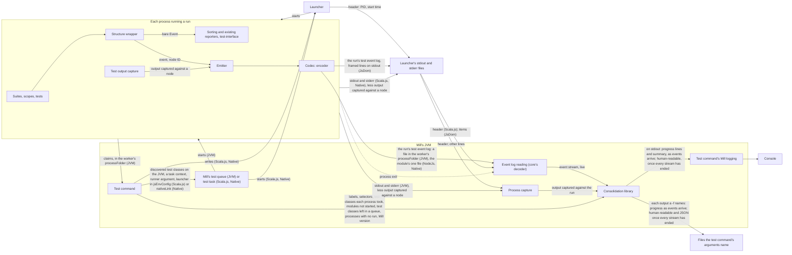

# Event-stream test reporting for Mill: architecture

Decisions: [ARCHITECTURE-DECISIONS.md](ARCHITECTURE-DECISIONS.md).

## Summary

Every run a test command starts must get its events, test structure and captured output out of its process on the JVM, Scala.js and Native, without changing what ScalaTest 3.2.x reporters receive (`SPECIFICATION.md` § Constraints). The test classes a process took to run must be known even where it dies before it sends anything. One Mill command must consolidate what every run sends, while Mill's own test tasks behave as they do without the plugin.

## Modules

Three deployable units.

### ScalaTest core

`scalatest-core`, on every runtime and Scala version `SPECIFICATION.md` § Scope covers. Every part below is internal (`private[scalatest]`).

- **Structure wrapper** — an internal reporter handed to each suite, nested suite and test through `Args.reporter`. It hands the emitter each `Event` it receives, tagged with its node's ID, its parent's ID, its declared position among its siblings and its name (`ARCHITECTURE-DECISIONS.md` "Structure is attached where each event is emitted…").
  - It sits ahead of the sorting reporters, which hold events back, so the emitter receives each event as it is emitted.
  - Each suite's wrapper mints the IDs of the suite, its scopes and its tests, unique within the run, and tracks the scopes its node opens and closes.
  - It passes the bare `Event` on to the reporter it wraps. It adds no event, removes none and changes no field, so every existing reporter receives what it receives without the wrapper (`SPECIFICATION.md` R-002).
  - An event that bypasses its own node's wrapper is tagged by the nearest enclosing wrapper that receives it, which belongs to an ancestor of the emitting node (R-097).
- **Test output capture** — inside the run's process, captures output it can tie to a suite, scope or test against that node, and hands it to the emitter.
  - Output it captures against a node is withheld from the process's stdout and stderr; everything else passes through to them. `SPECIFICATION.md` R-088 forces this, because what passes through is captured again off those streams (§ APIs § The emitter and the Mill plugin).
- **Emitter** — when the runner argument is given, sends what § APIs § The emitter and the Mill plugin lists in the run's test event log.
  - It is not a `-C` reporter opened on `RunStarting`, which could not send item 1 in time: on the JVM such a reporter can open after the runner's construction returns (`research/jvm-file-channel.md` § 5), and ScalaTest's Scala.js and Native runners ignore `-C` reporters and build no `RunStarting` (`research/node-native-file-channel.md` § 1).
- **Codec** — the one implementation of the event log's format. The encoder runs in every run with the emitter on; the decoder runs in the Mill plugin's event log reading, in Mill's JVM.
- **Argument splitter** — in package `org.scalatest.tools`, beside `ArgsParser`: takes ScalaTest arguments and returns them grouped by flag, each with its values. It shares `ArgsParser.parseArgs`'s arities, or is tested against `parseArgs` over every flag, so that a flag's values are never read as flags. It runs in Mill's JVM (§ Data flow).

### Consolidation library

JVM only, in package `org.scalatest`, depending on scalatest-core and meeting `SPECIFICATION.md` R-023. It takes each event stream in the form core's decoder yields it, and reuses two `private[scalatest]` parts of core, its formatting of human-readable output and its argument splitter, which is why it sits in core's package. The Mill plugin, outside that package, reaches the argument splitter only through the library (§ APIs § The Mill plugin and the consolidation library).

- **Assembly** — builds each run's test structure from its event stream as it arrives.
- **Runs that do not finish** — once a run's event stream ends without how the run ended, marks the run, and each node it left open, aborted (`SPECIFICATION.md` R-064).
  - For each run that did not finish, and each process that ended before any run existed in it, it reports by class name each test class the process took (§ Modules § Mill plugin, Test manifest) that no run reported as a suite (R-066, R-094). A class is shown once, however many processes took it.
- **Consolidation** — places every run's suites under the run's test run label, with one run record per run (R-078, R-080), beside the library's other inputs (§ APIs).
- **Writers** — write progress output as events arrive (R-026), and the human-readable and JSON output once every event stream has ended (R-027).

### Mill plugin

Built by its own Mill build inside this repo, not the sbt build, against the locally published scalatest-core and consolidation library. It hosts the consolidation library and adds the test command.

- Mill fixes the plugin's Scala version: Mill `1.3.1`, the release the plugin is built against, is built on Scala 3.9.0, while core's Scala 3 build is 3.3.8. The plugin loads core's and the library's Scala 3 builds into Mill's JVM.
- Its integration tests run under Mill's testkit.
- Mill API marked `@experimental` or `@internal`, or declared `private[mill]`, is used only from classes that the test command alone loads (`decisions/test-command.md` "On an unsupported Mill release, the test command runs and warns.").
- **Test command** — resolves the module selectors, runs every selected module's tests (§ Data flow), compiles each module's test manifest, and gives the library each run's event stream and its other inputs.
- **Test manifest** — gives the library the test classes each of a module's processes took, and those none took. A class's nested suites, scopes and tests are known only from a suite the run constructed (§ APIs § The emitter and the Mill plugin, item 2). The test command writes no file for it (`ARCHITECTURE-DECISIONS.md` "The test manifest is compiled from Mill's test queue and claim files on the JVM…").
  - On the JVM it is the files of Mill's own test queue, which the test command lays out before it starts any worker (`research/mill-test-worker-args.md` § 1.2): each fork group's `test-classes/` queue, with one file for each class the test command's class globs keep, and each worker's `claim/` folder and `claim.log` in its `processFolder`. A fork group is known by its queue folder.
    - A class is either unclaimed in its group's queue or recorded in a worker's `claim.log`; a worker took each class its `claim.log` records. The test command compiles the manifest from these files once a worker has ended (§ APIs § The emitter and the Mill plugin).
    - A worker's claims are tied to the worker by its `processFolder`, even where the worker dies before it writes an event log: the test command starts each worker in a folder it chose.
    - On Windows two workers' `claim.log` can record one class while its file is in one `claim/` folder (`research/emitter-plugin-spike.md` § 2). Such a class is taken by both, and counts as reported if any run reported it.
    - The queue and claim layout is `@internal` to Mill. The test command already relies on it to drive the queue (`research/mill-test-worker-args.md` § 2.2; `research/mill-parallel-worker-capture.md` § 6).
    - The files last until the next test command clears the module's folder (§ APIs § The emitter and the Mill plugin).
  - Scala.js and Native have no queue and no claims. The test command holds the module's test classes in memory (§ Data flow), and the module's one process takes them all (§ External systems).
- **Event log reading** — reads each run's test event log live and decodes it with core's codec into that run's event stream. It reads the event log file in each JVM worker's `processFolder`, each Scala.js `NodeJs` or Native module's one event log file and, under `JsDom`, the launchers' stdout files, and ends each stream as § APIs § The emitter and the Mill plugin describes.
- **Process capture** — captures each run's processes' stdout and stderr, against the run (`SPECIFICATION.md` R-042). On Scala.js and Native it takes them from launchers' files, each tied to its run by its header (§ APIs § The emitter and the Mill plugin), so that R-040, R-042 and R-073 hold there (`ARCHITECTURE-DECISIONS.md` "Every Scala.js VM starts through a launcher…" and "Every Native test binary starts through a launcher…").
- **Scala.js launcher** — starts every Scala.js VM, under `NodeJs` and `JsDom` alike, in place of the `executable` in the module's `jsEnvConfig`. It carries the module's launcher folder and the original `executable`, which it starts with the arguments and environment it receives: the config's `args` and `env`.
  - It writes the VM's stdout and stderr to its own pair of files in the module's launcher folder. The stdout file's first line is a header holding the VM's PID and a start time that matches `ProcessHandle`'s.
  - On Windows it is a small C program that runs the executable in a job object, so killing the launcher kills the VM. The plugin's own Mill build compiles it for x86-64 and ships it as a resource in the plugin jar; Windows on ARM64 runs it under emulation.
  - On POSIX (Linux and macOS) it is a `/bin/sh` script that `exec`s the executable, so the launcher becomes the VM. On Linux the header's start time comes from `/proc`. macOS has no `/proc`, so there the header carries the PID only, and the plugin takes the start time from `ProcessHandle` when it first reads the header.
- **Native launcher** — stands in for every Native test binary. It starts `<CROSSCOMPILING_EMULATOR words> <binary> <port>` itself, and writes the binary's stdout and stderr to its own pair of files in the module's launcher folder.
  - It is compiled with the module's `nativeClang`, because an emulator such as `qemu-user` cannot load a script. The launcher folder and the real binary's path are compiled into it, not passed through the environment, so the binary's environment is unchanged (`SPECIFICATION.md` R-053).
  - The stdout file's first line is a header holding the binary's PID and a start time that matches `ProcessHandle`'s.
- The test command writes each module's launcher into its launcher folder once per command, and swaps it into the module's test task (§ Data flow).

## APIs

### The emitter and the Mill plugin

- **The runner argument** — one ScalaTest runner argument, among those the test command adds to each run's arguments (`SPECIFICATION.md` R-053, R-125). It turns the emitter on and turns off the reporter ScalaTest uses when no reporter is configured (`SPECIFICATION.md` R-041). It reaches the runner on every runtime and in every JS environment the epic covers.
  - Where the test event log is a file (below), the argument carries its path. On Scala.js under `NodeJs` and on Native that is the absolute path of the module's one event log file.
  - On the JVM each worker is given the absolute path of the file in its own `processFolder`, whether the module's test sandboxing (`testSandboxWorkingDir`) is on or off. A worker's framework arguments are those of the `TestModuleUtil` its subprocess call is made on, so the test command makes each worker's call on one built with that worker's arguments (`research/jvm-per-worker-event-log-path.md` § 1, § 2, § 5).
  - Mill's discovery runner, which is not a run, gets no runner argument and so opens no test event log (`SPECIFICATION.md` R-072; § Data flow). Scala.js and Native have no discovery runner (`research/mill-worker-channels.md` § 4).
- **The run's test event log** — carries exactly one run, in the codec's format, which is private and read only by the release that wrote it (`decisions/event-log-contract.md`). In order:
  1. before the runner's construction returns, that the run exists (R-071, R-080), with:
     - the run-level values of its run record known then;
     - on the JVM, under `NodeJs` and on Native, its process's PID;
     - on the JVM and Native, its process's start time;
     - under `JsDom`, the ID the run gives itself at construction;
  2. when a suite starts running, once ScalaTest's filter is known, that suite's structure after filtering: its nested suites, scopes and tests, each with its node ID, its parent, its declared position and its name;
  3. events, captured output, and what the outputs need that events lack (`research/emission-gap-analysis.md`):
     - each tagged with its node's ID, a suite's only after that suite's structure;
     - events and messages attached to the run rather than to a suite tagged as the run's;
  4. how the run ended (R-074).

  Items 2 and 3 repeat for each suite. A run given no task sends only items 1 and 4, and item 4 only if it ends (R-071). No run sends a whole-run tree before it starts its first suite (`decisions/run-that-does-not-finish.md` "A suite's scopes and tests come from the run, one suite at a time…"). The event log carries only what the consolidated output shows or uses (`decisions/event-log-contract.md` "A test event log carries what the consolidated output shows or uses, not the whole event.").

  - **On the JVM, on Scala.js under `NodeJs` and on Native,** the event log is one file per run, at the path the runner argument gives. The run appends each item to it unbuffered as it occurs, and the plugin reads it while the run appends (`ARCHITECTURE-DECISIONS.md` "On the JVM, on Scala.js under `NodeJs` and on Native, a run's test event log is one file per run.").
    - On the JVM the file has one fixed name, which Mill does not use, in the worker's `processFolder`. It is not in the worker's `sandbox`, so the tests' working directory holds nothing new (`SPECIFICATION.md` R-053). Mill writes a `processFolder`'s `testargs` with `CREATE_NEW`, so it starts at most one JVM there in one test command and the name cannot collide (`research/mill-test-worker-args.md` § 2.3). The plugin reads the file in each `processFolder` it starts a worker in.
    - On Scala.js and Native the file is in the folder the test command owns for the module (R-110). Mill's test task gives the module one run in one process (§ External systems), so the module has one event log file.
    - Before any test starts, each test command clears the folder it owns for each selected module, which holds every `processFolder`, and creates the module's launcher folder afresh. No earlier command's file is then read as a run (R-022, R-077), and Mill's `CREATE_NEW` write of `testargs` succeeds. The launcher folder holds the module's launcher and the file pairs it writes. Each task folder R-110 names is that task's Mill `Task.dest`.
    - The event log file never exists under its name without its complete item 1. On the JVM a `processFolder` that holds no event log file once its worker has ended is therefore a worker in which no run existed.
      - Such a worker gives no PID to watch (below). It has ended when Mill's test-runner subprocess call that started it returns. The plugin uses that return only where no event log file appeared; its captured output is then complete and its claims final.
  - **Under `JsDom`,** the event log is framed lines in the launcher's stdout file (`ARCHITECTURE-DECISIONS.md` "Under `JsDom`, a run's test event log is framed lines…"). The run writes each item as one line with the window's `console.log`, which jsdom forwards to Node's stdout.
    - A line is an item only if it carries the framing prefix and this test command's nonce, both given by the runner argument, and the run's ID from item 1. Every other line is ordinary output of the process (below).
  - **The end of a run's event stream** is the exit of the run's process. The plugin watches the process with `ProcessHandle`, given its PID and start time. On the JVM and Native these come from item 1. On Scala.js they come from the header of the run's launcher (§ Modules § Mill plugin; below). A PID counts as exited if it is already gone, has no start time, or its process's start time differs from the one given. After the exit the plugin reads the event log to its end, since the exit can be signalled before the reader has caught up (`ARCHITECTURE-DECISIONS.md` "The plugin learns that a run's stream has ended when the run's process exits.").
- **Each process's stdout and stderr** — carry everything the run's processes write that capture did not take against a node. The plugin captures them against the run. On Scala.js and Native they are the launcher's pair of files, without the header and, under `JsDom`, without the event log's items.
  - On the JVM a worker's stdout and stderr belong to the run whose event log file is in the worker's `processFolder`.
  - A pair belongs to the run whose item 1 carries its header's PID, on Scala.js under `NodeJs` and on Native, and under `JsDom` to the run whose items its stdout file holds.
  - A pair is complete once the process its header names has exited, so the output of a process that ends before any run exists in it is captured whole (`SPECIFICATION.md` R-076).
  - On Native the header and item 1 carry the same PID and start time: the plugin ends the run's event stream by item 1's, and the pair by the header's.

### The Mill plugin and the consolidation library

The Mill plugin is the library's only caller (`decisions/event-log-contract.md` "The consolidation library's API carries no compatibility promise…"). Its operations:

- **Split a module's ScalaTest arguments**: returns them grouped by flag, each with its values, from core's argument splitter (§ Modules § ScalaTest core). The test command calls it before it starts the module's tests.
- **Start** a consolidation, given:
  - a sink for each output on stdout and in each file (`SPECIFICATION.md` R-048, R-049):
    - progress output on stdout: one for whole lines on stdout and one for the summary rewritten in place on Mill's prompt (R-089, R-090);
    - every other output: one text sink;
  - for each human-readable output, the formatting and filtering characters of the `-o` or `-f` that names it (R-127);
  - for human-readable output on stdout, whether Mill colours its own console output (R-124), which the plugin reads in Mill's JVM as `Task.log.prompt.colored` (`decisions/outputs.md` "Human-readable output on stdout is coloured where Mill colours its own console output.");
  - each module selector, with the test modules it resolved to;
  - where the caller gives them, the name and version of the build tool that started the runs, whether that version is supported, and a warning to show.
- **Add a run**: its event stream, fed live as the test event log is decoded, with the test run label the caller names for it, and the output captured from the stdout and stderr of the run's processes (`SPECIFICATION.md` R-042), as one sequence of lines in the order the caller read them, each line tagged with its stream.
  - The caller splits each stream into lines and decodes them to text before adding them, since a stream reaches it in chunks that can split a line or a character (`research/mill-worker-channels.md` § 1.3).
  - It adds a stream's unterminated last line once that stream ends, so a process that dies keeps its last line (R-073).

  Once the run's process has ended, the caller adds the test classes that process took, from the module's test manifest (§ Modules § Mill plugin).
- **Add a process that ended before any run existed in it** (`SPECIFICATION.md` R-076), with its test run label, the test classes it took, and the output captured from its stdout and stderr, in the form **Add a run** takes it.
- **Add a module whose tests did not start** (R-058, R-114), with its test run label and, where a failure stopped them, that failure.
- **Add a test class** left in a fork group's queue when the group's last worker ended (R-068).
- **End**, once every event stream has ended: the library writes the human-readable and JSON output.

## Data flow

The test command runs each selected module's tests under a task context it supplies (`decisions/test-command.md` "A test module needs no change to its definition for the test command to run it."). It gives each run:

- the module's own ScalaTest arguments that `SPECIFICATION.md` R-125 allows, found with the argument splitter;
- the test command's class globs and framework arguments as ScalaTest arguments, converted where ScalaTest takes them in another form (R-053);
- the arguments it adds, the runner argument among them.

It runs the tests:

- on the JVM, it runs the module's test discovery itself without the runner argument, then drives Mill's test queue, starting each worker through Mill's test-runner subprocess call (`ARCHITECTURE-DECISIONS.md` "The plugin runs a module's test discovery itself…");
- on Scala.js and Native, it evaluates the module's own Mill test task. In that evaluation only, it swaps in the module's launcher: on Scala.js the value of `jsEnvConfig` becomes a copy whose `executable` is the launcher, and on Native the value of `nativeLink` becomes the launcher (`ARCHITECTURE-DECISIONS.md` "The plugin installs each launcher by replacing a task's value…").

Before it starts any of a module's test processes, the test command holds the module's test classes, from which it later compiles the test manifest (§ Modules § Mill plugin):

- on the JVM, as the queue it lays out for each fork group from its own discovery, which starts no test;
- on Scala.js and Native, from test classes it learns itself before it evaluates the test task, because Mill's test task discovers them only inside its own body (`research/mill-worker-channels.md` § 4).

All of this runs in one nested evaluation of the test command's own, with fail-fast off (`ARCHITECTURE-DECISIONS.md` "The test command runs every selected module's tests in one nested evaluation of its own…").

Under `--halt-on-failure`, once anything has failed the test command, it withholds the tests of every selected module not yet started (`SPECIFICATION.md` R-057). It can do so because it supplies each module's task context and, through event log reading, sees every run's failures.

*A run never writes to the console: what it reports reaches the console only through the consolidation library.*

- Progress output and human-readable output reach the console through the test command's Mill logging, which shares the console with Mill's prompt (`decisions/capture-and-console.md` "On the console, progress output is a one-line summary…").
- Failure path: a process that dies.
  - The run's event stream ends without how the run ended (§ APIs § The emitter and the Mill plugin), holding everything the run had handed to the operating system (`SPECIFICATION.md` R-073). The library treats it as a run that does not finish (R-064–R-067), and progress output shows it aborted as soon as the stream ends (R-067).
  - Because each suite's structure arrives as the suite starts, every scope and test a constructed suite registered is known when the process dies (R-065). A suite the run never constructed sent nothing, so only its class is known, from the module's test manifest.
  - What the process wrote to stdout and stderr still reaches the library through process capture.
  - A process that dies before any run exists in it writes nothing to a test event log; the plugin adds it to the library with the output captured from its streams (R-076) and the test classes it took.
  - On the JVM the library still reports each class the dead worker took that no run reported, from the worker's claims (§ Modules § Mill plugin, Test manifest). A worker claims one class at a time, so that is at most the class it held when it died. Classes no worker claimed stay in the queue (R-068).

## External systems

- **Mill** — hosts the plugin in its JVM. Its fork grouping, test parallelism and test queue decide which processes run each module's tests. The test command must keep them, including on the JVM, where it drives the test queue itself (`SPECIFICATION.md` R-053). `ScalaJSModule.testFrameworkInstance` uses the module's `jsEnvConfig` only to build the JS environment, and `TestScalaNativeModule.testTask` uses `nativeLink` only as the test binary. That is what lets the test command swap in a launcher (`research/js-stdout-launcher.md` § 2.1; `research/mill-test-without-module-trait.md` § 3.3).
- **Scala.js and Native test adapters** — launch the Node VM or native binary that runs a Scala.js or Native run, in Mill's own working directory, and carry the framework arguments to its runner unchanged, including in `JsDom` window code (`research/js-environment-channels.md` § 2.2; `research/node-native-file-channel.md` § 7). Under Mill's test task each run executes in one Node VM or native binary, which carries no other run and exits shortly after it (`research/js-native-structure-and-capture.md` § 1.3; `research/node-native-file-channel.md` § 4, § 5.2).
  - The Scala.js adapter runs the `jsEnvConfig`'s `executable` with its `args` and `env`. When it closes a run it calls `destroyForcibly()` on that process, which on Linux closes Mill's pipes to it and discards what Mill had not read (`research/jsdom-channel.md` § 4).
  - The Native adapter runs `<CROSSCOMPILING_EMULATOR words> <binaryFile> <port>` on Mill's own stdin, stdout and stderr (`inheritIO()`), so no byte the binary writes passes through Mill's JVM (`research/js-native-channels.md` § 1.2, § 5.2).
  - `JsDom` window code has no `require` and no `process`, so a `JsDom` run can write no file, open no Node socket, and learn neither its PID nor its start time (`research/jsdom-channel.md` § 1).
- **Metals, Bloop and IntelliJ** — launch runs without the runner argument, so the emitter stays off and every reporter receives what 3.2.19 sends (`SPECIFICATION.md` R-001, R-003).
  - In IntelliJ's *forked* mode, its reporter writes TeamCity service messages (`##teamcity[…]`) to stdout, inferring each node's parent from `Ordinal` prefixes and `suiteId`. It needs each `SuiteStarting` and `ScopeOpened` before the tests inside it and every open closed, and silently drops event types it does not know.
  - In *sbt shell* mode, IntelliJ parses the text ScalaTest prints with regular expressions.
