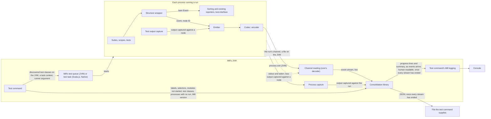

# Event-stream test reporting for Mill: architecture

Decisions: [ARCHITECTURE-DECISIONS.md](ARCHITECTURE-DECISIONS.md).

## Summary

Every run a test command starts must get its events, test structure and captured output out of its process on the JVM, Scala.js and Native, without changing what ScalaTest 3.2.x reporters receive (`SPECIFICATION.md` § Constraints). One Mill command must consolidate every run's channel, while Mill's own test tasks behave as they do without the plugin. scalatest-core gains an emitter that sends each run's structure, events and captured output as they happen. A consolidation library builds the consolidated output from many runs' event streams. A Mill plugin's test command runs each selected module's tests with the emitter on and feeds what each run sends to the library.

## Modules

Three deployable units, released together as one release of this fork (`decisions/channel-contract.md` "Every release of the Mill plugin is a release of the fork.").

### ScalaTest core

`scalatest-core`, on every runtime and Scala version `SPECIFICATION.md` § Scope covers. Every part below is internal (`private[scalatest]`).

- **Structure wrapper** — taken from `../structured-test-reporting/ARCHITECTURE.md` § Modules § ScalaTest core (Structure wrapper) and placed ahead of the sorting reporters, so the emitter receives each event as it is emitted, with its node's ID, parent, declared position and name.
- **Test output capture** — inside the run's process, captures output it can tie to a suite, scope or test against that node, and hands it to the emitter.
  - Output it captures against a node is withheld from the process's stdout and stderr; everything else passes through to them. `SPECIFICATION.md` R-088 forces this, because what passes through is captured again off those streams (§ APIs § The emitter and the Mill plugin).
- **Emitter** — when the runner argument is given, sends what § APIs § The emitter and the Mill plugin lists over the run's channel.
- **Codec** — the one implementation of the channel's format. The encoder runs in every run with the emitter on; the decoder runs in the Mill plugin's channel reading, in Mill's JVM.

Under Mill, a Scala.js or Native run executes in one process (`../structured-test-reporting/ARCHITECTURE.md` § External systems, Scala.js and Native test interface), as each JVM test-worker run does, so each run's emitter runs in one process.

### Consolidation library

JVM only, in package `org.scalatest`, depending on scalatest-core and meeting `SPECIFICATION.md` R-023. It takes each event stream in the form core's decoder yields it, and reuses core's `private[scalatest]` formatting of human-readable output, which is why it sits in core's package.

- **Assembly** — builds each run's test structure from its event stream as it arrives.
- **Runs that do not finish** — once a run's event stream ends without how the run ended, marks the run, and each node it left open, aborted (`SPECIFICATION.md` R-064–R-067).
- **Consolidation** — places every run's suites under the run's test run label, with one run record per run (R-078, R-080), beside the library's other inputs (§ APIs).
- **Writers** — write progress output as events arrive (R-026), and the human-readable and JSON output once every event stream has ended (R-027).

### Mill plugin

Built by its own Mill build inside this repo, not the sbt build, against the locally published scalatest-core and consolidation library. It hosts the consolidation library and adds the test command.

- Mill fixes the plugin's Scala version: Mill `1.1.10` is built on Scala 3.8.2, while core's Scala 3 build is 3.3.8. The plugin loads core's and the library's Scala 3 builds into Mill's JVM.
- Its integration tests run under Mill's testkit.
- Mill API marked `@experimental` or `@internal`, or declared `private[mill]`, is used only from classes that the test command alone loads (`decisions/test-command.md` "On an unsupported Mill release, the test command runs and warns.").
- **Test command** — resolves the module selectors, runs every selected module's tests (§ Data flow), and gives the library each run's event stream and its other inputs.
- **Channel reading** — reads each run's channel live, on the JVM every file in each module's folder, decodes it with core's codec into that run's event stream, and on a JVM worker ends the stream as § APIs § The emitter and the Mill plugin gives.
- **Process capture** — captures each run's processes' stdout and stderr, against the run (`SPECIFICATION.md` R-042).

## APIs

### The emitter and the Mill plugin

- **The runner argument** — one ScalaTest runner argument, appended to the framework arguments the test command passes each selected module. It turns the emitter on and turns off the reporter ScalaTest uses when no reporter is configured (`SPECIFICATION.md` R-041). It reaches the runner on every runtime and in every JS environment the epic covers.
  - Every run of a module receives the same argument, and each run derives from it a channel of its own.
  - Mill's discovery runner, which is not a run, gets no runner argument and so opens no channel (`SPECIFICATION.md` R-072; § Data flow). Scala.js and Native have no discovery runner (`research/mill-worker-channels.md` § 4).
- **The run's channel** — carries exactly one run, in the codec's format, which is private and read only by the release that wrote it (`decisions/channel-contract.md`). In order:
  1. when the runner is constructed, that the run exists, with the run-level values its run record holds that are known then and, on a JVM worker, the PID and start time of its process (R-071, R-080);
  2. when a suite starts running, once ScalaTest's filter is known, that suite's structure after filtering: its nested suites, scopes and tests, each with its node ID, its parent, its declared position and its name;
  3. events, captured output, and what the outputs need that events lack (`research/emission-gap-analysis.md`):
     - each tagged with its node's ID, a suite's only after that suite's structure;
     - events and messages attached to the run rather than to a suite tagged as the run's;
  4. how the run ended (R-074).

  Items 2 and 3 repeat for each suite. A run given no task sends only items 1 and 4, and item 4 only if it ends (R-071). No run sends a whole-run tree before it starts its first suite (`decisions/run-that-does-not-finish.md` "A run's expected tests come from the run, one suite at a time…"). The channel carries only what the consolidated output shows or uses (`decisions/channel-contract.md` "A channel carries what the consolidated output shows or uses, not the whole event.").

  - **On a JVM worker** the channel is a file the run creates when its runner is constructed, with a name unique to the run, in the folder the runner argument names for the module. The run appends each item to it unbuffered as it occurs, and the plugin reads every file live while the run appends (`ARCHITECTURE-DECISIONS.md` "On a JVM worker, a run's channel is one file per run.").
    - The test command creates that folder, new for each test command and module, so no earlier command's file is read as a run (`SPECIFICATION.md` R-022, R-077).
    - The file exists by the time the runner's construction returns, so that a process dying before its first task still leaves a file for its run (R-071).
    - A file never exists in the folder without its complete item 1.
  - **The end of a run's event stream on a JVM worker** is the exit of the run's process. The plugin finds the process from item 1's PID and start time and watches it with `ProcessHandle`; a PID that is already gone, or whose process has a different start time, counts as exited. After the exit the plugin reads the channel to its end, since the exit can be signalled before the reader has caught up (`ARCHITECTURE-DECISIONS.md` "On a JVM worker, the plugin learns that a run's stream has ended when the run's process exits.").
- **Each process's stdout and stderr** — carry everything the run's processes write that capture did not take against a node. The plugin captures them against the run.

### The Mill plugin and the consolidation library

The Mill plugin is the library's only caller (`decisions/channel-contract.md` "The consolidation library's API carries no compatibility promise…"). Its operations:

- **Start** a consolidation, given:
  - a sink for each consolidated output that is on:
    - progress output: one for whole lines and one for a one-line summary rewritten in place (`SPECIFICATION.md` R-089, R-090);
    - human-readable and JSON output: one text sink each;
  - each module selector, with the test modules it resolved to;
  - where the caller gives them, the name and version of the build tool that started the runs, whether that version is supported, and a warning to show.
- **Add a run**: its event stream, fed live as the channel is decoded, with the test run label the caller names for it, and the output captured off the stdout and stderr of the run's processes (`SPECIFICATION.md` § Consolidation).
- **Add a process that ended before any run existed in it** (`SPECIFICATION.md` R-076), with its test run label and the output captured off its stdout and stderr.
- **Add a module whose tests did not start**, with its test run label and, where a failure stopped them, that failure (R-058).
- **Add a test class** left in a fork group's queue when the group's last worker ended (R-068).
- **End**, once every event stream has ended: the library writes the human-readable and JSON output.

## Data flow

The test command runs each selected module's tests under a task context it supplies, adding the runner argument to the framework arguments (`decisions/test-command.md` "A test module needs no change to its definition for the test command to run it."):

- on the JVM, it runs the module's test discovery itself without the runner argument, then drives Mill's test queue, starting each worker through Mill's test-runner subprocess call (`ARCHITECTURE-DECISIONS.md` "The plugin runs a module's test discovery itself…");
- on Scala.js and Native, it evaluates the module's own Mill test task.

All of this runs in one nested evaluation of the test command's own, with fail-fast off (`ARCHITECTURE-DECISIONS.md` "The test command runs every selected module's tests in one nested evaluation of its own…").

Under `--halt-on-failure`, once anything has failed the test command, it withholds the tests of every selected module not yet started (`SPECIFICATION.md` R-057). It can do so because it supplies each module's task context and, through channel reading, sees every run's failures.

*A run never writes to the console: what it reports reaches the console only through the consolidation library.*

- Progress output and human-readable output reach the console through the test command's Mill logging, which shares the console with Mill's prompt (`decisions/capture-and-console.md` "On the console, progress output is a one-line summary…").
- Failure path: a process that dies.
  - The run's event stream ends (on a JVM worker, as § APIs § The emitter and the Mill plugin gives) without how the run ended, holding everything the run had handed to the operating system (`SPECIFICATION.md` R-073). The library treats it as a run that does not finish (R-064–R-067), and progress output shows it aborted as soon as the stream ends (R-067).
  - Because each suite's structure arrives as the suite starts, every scope and test a constructed suite registered is known when the process dies (R-065); a suite the run never constructed sent nothing (R-066).
  - What the process wrote to stdout and stderr still reaches the library through process capture.
  - A process that dies before any run exists in it sends nothing over a channel; the plugin adds it to the library with the output captured off its streams (R-076).

## External systems

- **Mill** — hosts the plugin in its JVM. Its fork grouping, test parallelism and test queue decide the processes that run each module's tests, and the test command must keep them, on the JVM too, where it drives the test queue itself (`SPECIFICATION.md` R-053).
- **Scala.js and Native test adapters** — launch the Node VM or native binary that runs a Scala.js or Native run, and carry the framework arguments to its runner, including in `JsDom` window code (`research/js-environment-channels.md` § 2.2).
- **Metals, Bloop and IntelliJ** — launch runs without the runner argument, so the emitter stays off and every reporter receives what 3.2.19 sends (`SPECIFICATION.md` R-001, R-003).
