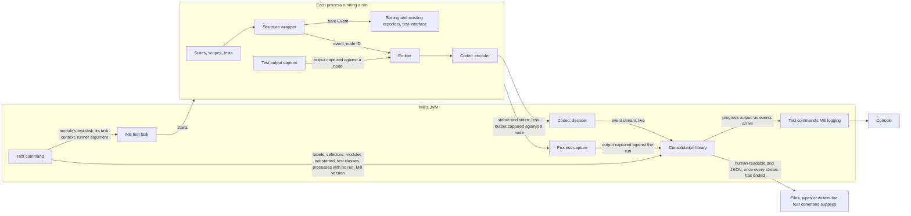

# Event-stream test reporting for Mill: architecture

Decisions: [ARCHITECTURE-DECISIONS.md](ARCHITECTURE-DECISIONS.md).

## Summary

Every run a test command starts must get its events, test structure and captured output out of its process on the JVM, Scala.js and Native, without changing what ScalaTest 3.2.x reporters receive (`SPECIFICATION.md` § Constraints), and one Mill command must consolidate every run's channel while Mill's own test tasks behave as they do without the plugin. scalatest-core gains an emitter that sends each run's structure, events and captured output as they happen. A consolidation library builds the consolidated output from many runs' event streams. A Mill plugin's test command runs each selected module's tests with the emitter on and feeds what each run sends to the library.

## Modules

Three deployable units, all released together as one release of this fork (`decisions/channel-contract.md` "Every release of the Mill plugin is a release of the fork.").

### ScalaTest core

`scalatest-core`, on the JVM, Scala.js and Native, on the Scala versions `../structured-test-reporting/SPECIFICATION.md` § Scope lists. Every part below is internal (`private[scalatest]`).

- **Structure wrapper** — taken from `../structured-test-reporting/ARCHITECTURE.md` § Modules § ScalaTest core (Structure wrapper), ahead of the sorting reporters, so the emitter receives each event as it is emitted, with its node's ID, parent, declared position and name.
- **Test output capture** — inside the run's process, captures output it can tie to a suite, scope or test against that node, and hands it to the emitter.
  - Output it captures against a node is withheld from the process's stdout and stderr; everything else passes through to them. This is forced by `SPECIFICATION.md` R-088: what passes through is captured again off those streams (§ APIs, The emitter and the Mill plugin).
- **Emitter** — when the runner argument (§ APIs) is given, sends the run's structure, events and captured output over the run's channel. It also sends what the outputs need that events lack, such as an aborted node's reason (*not run*, *process failed*), and how the run ended (R-074).
- **Codec** — the one implementation of the channel's format. The encoder runs in every run with the emitter on; the decoder runs in Mill's JVM, where the Mill plugin turns each run's channel into that run's event stream.

Under Mill, a Scala.js or Native run executes in one process (`../structured-test-reporting/ARCHITECTURE.md` § External systems, Scala.js and Native test interface), as each JVM test-worker run does, so each run's emitter runs in one process.

### Consolidation library

JVM only, in package `org.scalatest`, depending on scalatest-core and on no Mill artifact. It reuses core's codec and core's `private[scalatest]` formatting of human-readable output, which is why it sits in core's package. The Mill plugin is its only caller.

- **Assembly** — builds each run's test structure from its event stream as it arrives. This is not structured test reporting's in-run tree assembly.
- **Settling** — settles each run that does not finish once its event stream ends (`SPECIFICATION.md` R-064–R-067).
- **Consolidation** — places every run's suites under the run's test run label, with one run record per run (R-078, R-080), beside the library's other inputs (§ APIs).
- **Writers** — write progress output as events arrive (R-026), and the human-readable and JSON output once every event stream has ended (R-027).

### Mill plugin

Built by its own Mill build inside this repo, not the sbt build, against the locally published scalatest-core and consolidation library; a release publishes those two before building the plugin. It hosts the consolidation library and adds the test command.

- Mill fixes the plugin's Scala version: Mill `1.1.10` is built on Scala 3.8.2, while core's Scala 3 build is 3.3.8. The plugin loads core's and the library's Scala 3 builds into Mill's JVM.
- Mill's testkit runs the plugin's integration tests against each Mill release, which fixes the supported Mill releases (`SPECIFICATION.md` § Scope).
- Mill API marked `@experimental` or `@internal`, or declared `private[mill]`, is used only from classes that the test command alone loads, so R-060 and R-003 hold on any Mill release the plugin runs on (`decisions/test-command.md` "On an unsupported Mill release, the test command runs and warns.", Costs).
- **Test command** — resolves the module selectors, runs every selected module's tests (§ Data flow), and gives the library each run's event stream and its other inputs.
- **Channel reading** — reads each run's channel and decodes it with core's codec into that run's event stream, live.
- **Process capture** — captures each run's processes' stdout and stderr, against the run (`SPECIFICATION.md` R-042).

## APIs

### The emitter and the Mill plugin

- **The runner argument** — one ScalaTest runner argument, appended to the framework arguments the test command passes each selected module, naming where the run writes. It turns the emitter on and turns off the reporter ScalaTest uses when no reporter is configured (`SPECIFICATION.md` R-041). It reaches the runner on every runtime and in every JS environment the epic covers. Every run of a module receives the same argument (`../structured-test-reporting/ARCHITECTURE.md` § External systems, Mill), and so does Mill's discovery runner, which is not a run (`SPECIFICATION.md` R-072).
- **The run's channel** — carries exactly one run, in the codec's format, which is private and read only by the release that wrote it (`decisions/channel-contract.md`). In order:
  1. when a suite starts running, once ScalaTest's filter is known, that suite's structure after filtering: its nested suites, scopes and tests, each with its node ID, its parent, its declared position and its name;
  2. that suite's events and captured output, each tagged with its node's ID, and what the outputs need that events lack;
  3. how the run ended (R-074).

  No run sends a whole-run tree before it starts its first suite (`decisions/run-that-does-not-finish.md` first entry). The channel carries only what the consolidated output shows or uses (`decisions/channel-contract.md` "A channel carries what the consolidated output shows or uses, not the whole event.").
- **Each process's stdout and stderr** — carry everything the run's processes write that capture did not take against a node. The plugin captures them against the run.

### The Mill plugin and the consolidation library

The library carries no compatibility promise and has one caller (`decisions/channel-contract.md` "The consolidation library's API carries no compatibility promise…"). Its operations:

- **Start** a consolidation, given:
  - a file, pipe or writer for each consolidated output that is on;
  - each module selector, with the test modules it resolved to;
  - where the caller gives them, the name and version of the build tool that started the runs, whether that version is supported, and a warning to show.
- **Add a run**: its event stream, fed live as the channel is decoded, with the test run label the caller names for it, and the output captured off the stdout and stderr of the run's processes (`SPECIFICATION.md` § Consolidation).
- **Add a process that ended before any run existed in it** (`SPECIFICATION.md` R-076), with its test run label and the output captured off its stdout and stderr.
- **Add a module whose tests did not start**, with its test run label and, where a failure stopped them, that failure (R-058).
- **Add a test class** the caller knows was to run but that no run reported (R-068).
- **End**, once every event stream has ended: the library writes the human-readable and JSON output.

## Data flow

The test command evaluates each selected module's own Mill test task under its own task context (`decisions/test-command.md` "A test module needs no change to its definition for the test command to run it."), adding the runner argument to the framework arguments. It evaluates every selected module's test task in one nested evaluation of its own with fail-fast off (`ARCHITECTURE-DECISIONS.md` "The test command runs every selected module's tests in one nested evaluation of its own…").

*A run never writes to the console: what it reports reaches the console only through the consolidation library.*

- Progress output reaches the console through the test command's Mill logging (`decisions/capture-and-console.md` first entry).
- Failure path: a process that dies.
  - Its channel ends without how the run ended, holding everything the run had handed to the operating system (`SPECIFICATION.md` R-073). The library settles the run as one that does not finish (R-064–R-067), and progress output shows it aborted as soon as the stream ends (R-067).
  - Because each suite's structure arrives as the suite starts, every scope and test a constructed suite registered is known when the process dies (R-065); a suite the run never constructed sent nothing (R-066).
  - What the process wrote to stdout and stderr still reaches the library through process capture.
  - A process that dies before any run exists in it sends nothing over a channel; the plugin adds it to the library with the output captured off its streams (R-076).

## External systems

- **Mill** — hosts the plugin in its JVM and fixes the plugin's Scala version and supported Mill releases (§ Modules § Mill plugin).
  - Its test tasks start each module's processes under its fork grouping, test parallelism and test queue, which the test command must keep (`SPECIFICATION.md` R-053); the test command therefore evaluates each module's own test task rather than starting processes itself.
  - It runs a discovery runner from the same framework arguments before any worker starts (`../structured-test-reporting/ARCHITECTURE.md` § External systems, Mill).
  - Holding R-040, R-042 and R-044 needs Mill API that Mill does not keep stable (`decisions/capture-and-console.md` "`../SPECIFICATION.md` R-040, R-042 and R-044 hold on every runtime…").
- **Scala.js and Native test adapters** — launch the Node VM or native binary that runs a Scala.js or Native run, and carry the framework arguments to its runner, including in `JsDom` window code (`research/js-environment-channels.md` § 2.2).
- **Metals, Bloop and IntelliJ** — launch runs without the runner argument, so the emitter stays off and every reporter receives what 3.2.19 sends (`SPECIFICATION.md` R-001, R-003). They import a build that uses the plugin, so the plugin's use of unstable Mill API stays in classes only the test command loads (§ Modules § Mill plugin).
