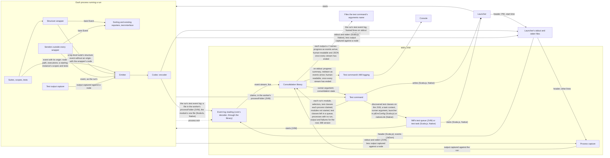

# Event-stream test reporting for Mill: architecture

Decisions: [ARCHITECTURE-DECISIONS.md](ARCHITECTURE-DECISIONS.md).

## Summary

Every run a test command starts must get its events, test structure and captured output out of its process on the JVM, Scala.js and Native, while the build tool still receives the test-interface events ScalaTest 3.2.20 sends (`SPECIFICATION.md` R-051). A run with the emitter off must leave what every reporter receives unchanged (`SPECIFICATION.md` R-001). The test classes a process claimed must be known even where it dies before it sends anything. One Mill command must consolidate what every run sends, while Mill's own test tasks behave as they do without the plugin.

## Modules

The epic has three deployable units. Every artifact of this fork, core's included, is published under Maven group `com.edc` (`decisions/architecture-library-and-modules.md` "Every artifact of this fork is published under Maven group `com.edc`…"). Every artifact of this fork is published only to the local Ivy repository (`~/.ivy2/local`), which Coursier, and so Mill, searches by default.

### ScalaTest core

Every artifact the fork's sbt build publishes, scalactic and the style artifacts included, keeps its upstream name and its runtime and Scala 3 suffixes, on every runtime `SPECIFICATION.md` § Scope covers. Each of these artifacts is built with Scala 3.3.8 (`decisions/architecture-library-and-modules.md` "The fork's sbt build compiles with Scala 3.3.8 on every runtime."), with Scala.js 1.20.2 on Scala.js and Scala Native 0.5.12 on Native. `scalatest-compatible`, which the JVM's `scalatest-core` depends on, is Java only and is the one artifact with no suffix. A test module tests with this fork by depending on the fork's artifacts as it would on upstream's, usually through `scalatest`. Every part below is in `scalatest-core`, which the other ScalaTest artifacts depend on, and is internal (`private[scalatest]`).

- **Structure wrapper** — an internal reporter handed to each suite, nested suite and test through `Args.reporter`. It hands the emitter each `Event` it receives that has no origin (Emitter, below). Events without an origin are those user code builds, those of an instance that is not registered, and a top-level suite's `SuiteStarting`, `SuiteCompleted` and `SuiteAborted`. The `SuiteStarting`, `SuiteCompleted` and `SuiteAborted` that core sends for a nested suite carry that suite's origin.
  - The wrapper recognises an event the emitter already has, handed off at its send site or by another wrapper, and does not hand that event off again. Only the innermost wrapper that an event without an origin reaches therefore hands that event off (`decisions/architecture-test-structure.md` "An event without an origin is assigned by the innermost structure wrapper it reaches…").
  - A top-level suite's wrapper is installed before the suite's `SuiteStarting` is reported. As the wrapper is installed, the wrapper reads the suite's structure (§ APIs § The emitter and the Mill plugin, the `structure` event) from the constructed suite, its nested suites and the run's filter, and hands that structure to the emitter.
  - The wrapper hands each event without an origin off with the wrapper's own node (Emitter, below).
  - The wrapper passes the bare `Event` on to the reporter it wraps. The wrapper adds no event, removes no event and changes no field of an event, so the build tool still receives the test-interface events 3.2.20 sends (`SPECIFICATION.md` R-051).
- **Test output capture** — inside the run's process, captures output it can tie to a suite, scope or test against that node, and hands it to the emitter.
  - Output it captures against a node is withheld from the process's stdout and stderr; everything else passes through to them. `SPECIFICATION.md` R-097a, which attaches each piece of output to one node, forces this, because what passes through is captured again off those streams (§ APIs § The emitter and the Mill plugin).
- **Emitter** — when the runner argument is given, writes every event the run reports, the run's test structure and the output the run captures to the run's one test event log, as § APIs § The emitter and the Mill plugin lists.
  - Events sent outside every structure wrapper, such as the runner's own run events, reach it by an explicit hand-off where they are sent, assigned to the run (`decisions/architecture-test-structure.md` "Events sent outside every structure wrapper reach the emitter by an explicit hand-off at each send site.").
  - A node's ID is its node path: its parent's node path followed by its place under that parent (`decisions/architecture-test-structure.md` "A node's ID is its node path…"):
    - a suite's place is its `suiteId` and its order among the suites with that `suiteId` under the parent. In a `structure`, that order is the suites' declared order. In the run, that order is the order in which the suites started within one execution of the parent. A top-level suite's parent is the run;
    - a scope's place is its registered text and its index among the scopes of that text under the same parent;
    - a test's place is its test name under its suite: a test's node path is its suite's node path followed by its test name, whichever scope the test sits in.

    Running a parent again runs the same places again: their nodes gain executions, not siblings.
  - Only while the run's emitter is on, the engine sets the *invocation context*: the node and execution the code on a thread runs in. It sets the run's context around each top-level suite's run. It sets a node's context around a suite's run outside its tests, each test body, each distributor task and each task on the engine's own async `ExecutionContext`. A suite instance whose run starts in a context is *registered*. Registration records the context's node and does not read the instance's `suiteId`. The instance builds its node path from that node and its own `suiteId`. A suite that a test runs is therefore a child of that test. A suite that another suite runs outside its tests, as a `runNestedSuites` override does, is a child of the running suite. An instance a suite runs outside its tests with the suite's own `suiteId`, as a per-test instance or the delegate of a `@WrapWith` wrapper, takes the suite's node path instead (`decisions/architecture-test-structure.md` "An instance a suite runs outside its tests that has the suite's `suiteId` is that suite's node…").
  - An instance whose run starts where no context is set, as on a thread or `ExecutionContext` user code supplies, is not registered and records nothing (`decisions/architecture-test-structure.md` "A suite instance run where no invocation context is set is not registered…"). A run without the runner argument sets no context, so it does no work for any instance (`SPECIFICATION.md` R-001).
  - Where core sends an event for a registered instance, it records the event's node and executions, in the emitter and never on the event: the event's *origin*. It hands the event to the emitter there and then (`decisions/architecture-test-structure.md` "An event core sends for a registered instance is handed to the emitter where it is sent…"). An event without an origin is resolved from its own data, at or below the node of the wrapper that hands it off. Where such an event names a suite that no node at or below the wrapper's node has, the emitter adds that suite directly under the wrapper's node, at index 0 among the suites with its `suiteId`.
    - An event of a suite, scope or test is therefore assigned to its own node even where it bypasses that node's wrapper. Only a message whose node nothing identifies is assigned to the node of the wrapper that hands it off, which is an ancestor of the message's node (`SPECIFICATION.md` R-097b).
  - It sends a further `structure` event (§ APIs § The emitter and the Mill plugin, the `structure` event) when the run learns more of a suite's structure:
    - a registered instance starts at a place a `structure` declared, and its scopes and tests differ from those of the latest `structure` that declares that place;
    - a registered instance starts at a place no `structure` declared. A suite that a test runs starts at such a place, as does a suite that starts beside more siblings sharing its `suiteId` than its parent's `structure` declared;
    - an event without an origin names a suite or test that no `structure` contains.
  - It numbers each node's executions (§ APIs § The emitter and the Mill plugin, item 3).
  - It is core's own reporter, not a `-C` reporter (`decisions/architecture-test-event-log.md` "The Mill plugin turns the emitter on with a ScalaTest runner argument.").
- **Codec** — the one implementation of the event log's format (§ APIs § The emitter and the Mill plugin). The encoder runs in every run with the emitter on; the decoder runs in Mill's JVM. Each side is tested on its own against the format (`decisions/architecture-test-event-log.md` "Each side of core's codec is tested on its own…").
  - The codec encodes and decodes the format by hand, since core builds for the JVM, Scala.js and Native and takes no serialisation library.
  - The decoder yields each ScalaTest event as a member of the decoded event family, one class per `org.scalatest.events` class, containing what the event log carries of that event (`decisions/architecture-test-event-log.md` "Core's decoder yields each ScalaTest event as a member of a decoded event family…").
- **Runner argument definition** — the one definition of the runner argument's spelling and syntax (§ APIs § The emitter and the Mill plugin). Core's own argument parsing reads the argument through it.
- **Argument splitter** — in package `org.scalatest.tools`, beside `ArgsParser`: takes ScalaTest arguments and returns them grouped by flag, each with its values. Its arities match `ArgsParser.parseArgs`'s, so that a flag's values are never read as flags. It runs in Mill's JVM (§ Data flow).

### Consolidation library

`scalatest-consolidation`, published as `scalatest-consolidation_3`: JVM and Scala 3 only, as its one caller, the Mill plugin, runs on Scala 3. It is in package `org.scalatest`, depends on scalatest-core and meets `SPECIFICATION.md` R-023. It takes each event stream in the form core's decoder yields it. It sits in core's package because it reuses four `private[scalatest]` parts of core: its formatting of human-readable output, its decoder, its argument splitter and its definition of the runner argument.

- **Assembly** — builds each run's test structure from its event stream as it arrives.
  - It keeps each node's events against the node's ID, by execution, apart from the structure. The writers report each suite's latest structure, with those events.
  - Each node takes the parent its `structure` declares, which for a suite or scope the format requires to be its node path without the last place. A suite or scope takes its name from the `structure` that contains it. A test takes its parent scope, its name and its label from the latest `structure` that contains the test.
  - A node the latest structure lacks stays at the place it last had, whether or not it has events (`SPECIFICATION.md` R-130b).
- **Runs that do not finish** — applies `SPECIFICATION.md` R-095a, R-095b and R-102 to each run whose event stream ends without its `runEnded` event (§ APIs § The emitter and the Mill plugin, "What the library takes").
  - Among the test classes each process claimed, it finds each class that no run reported as a suite, and adds that class as a suite node aborted with reason *not run* (`SPECIFICATION.md` R-095a; § Modules § Mill plugin, Test manifest).
- **Consolidation** — builds the one node tree every output uses (`SPECIFICATION.md` R-020, R-096a, R-136): the root, each module under the root, and each run under its module, beside what the library's other operations add (§ APIs § The Mill plugin and the consolidation library).
  - A run is one execution of `Runner`, so each module whose tests start has at least one run (`.docs/ubiquitous-language.md` **Run**).
  - A run in a forked JVM is a run node under its module, and the run's top-level suites sit under that run node. Any other run has no run node: its top-level suites sit directly under its module (`SPECIFICATION.md` R-135).
  - A run's own state and the output captured against the run are held on the run's run node, or on the run's module where the run has no run node.
- **Writers** — write the progress, human-readable and JSON output (`SPECIFICATION.md` R-026, R-027). The human-readable and JSON writers run at **End** (§ APIs § The Mill plugin and the consolidation library).
  - The human-readable output ends with a summary line. Once every event stream has ended, progress output's summary equals that line, whether or not progress output is on (`SPECIFICATION.md` R-141).
- **Consolidation state** — records whether the consolidation has ended and whether anything has failed the test command (§ APIs § The Mill plugin and the consolidation library, **Read the consolidation state**).

### Mill plugin

`scalatest-mill`, published as `scalatest-mill_mill1_3`, Mill 1.x's plugin form. The plugin is built by its own Mill build inside this repo, not the sbt build, against the locally published scalatest-core and consolidation library. It hosts the consolidation library and adds the test command.

- Mill fixes the plugin's Scala version: Mill `1.3.1`, the release the plugin is built against, is built on Scala 3.9.0, while core and the library are built with Scala 3.3.8 (§ ScalaTest core). The plugin loads both into Mill's JVM.
- The plugin's integration tests run under Mill's testkit.
- Mill API marked `@experimental` or `@internal`, or declared `private[mill]`, is used only from classes that the test command alone loads (`decisions/test-command.md` "On an unsupported Mill release, the test command warns on the console and in every file output…").
- **Test command** — resolves the module selectors, runs every selected module's tests (§ Data flow), compiles each module's test manifest, and gives the library each run's event stream and its other inputs. It derives no result from any event (§ APIs § The Mill plugin and the consolidation library, **Read the consolidation state**).
- **Test manifest** — gives the library the test classes each of a module's processes claimed, and those none claimed. A class's nested suites, scopes and tests are known only from a suite the run constructed (§ APIs § The emitter and the Mill plugin, the `structure` event). The test command writes no file for it (`decisions/architecture-running-tests.md` "The test manifest is compiled from Mill's test queue and claim files on the JVM…").
  - On the JVM it is the files of Mill's own test queue, which the test command lays out before it starts any worker (`research/mill-test-worker-args.md` § 1.2): each fork group's `test-classes/` queue, with one file for each class the test command's class globs keep, and each worker's `claim/` folder and `claim.log` in its `processFolder`. A fork group is known by its queue folder.
    - A class is either unclaimed in its group's queue or recorded in a worker's `claim.log`; a worker claimed each class its `claim.log` records. The test command compiles the manifest from these files once a worker has ended (§ APIs § The emitter and the Mill plugin).
    - A worker's claims are tied to the worker by its `processFolder`, even where the worker dies before it writes an event log: the test command starts each worker in a folder it chose.
    - On Windows two workers' `claim.log` can record one class while its file is in one `claim/` folder (`research/emitter-plugin-spike.md` § 2). Such a class is claimed by both, and counts as reported if any run reported it.
    - The queue and claim layout is `@internal` to Mill. The test command already relies on it to drive the queue (`research/mill-test-worker-args.md` § 2.2; `research/mill-parallel-worker-capture.md` § 6).
    - The files last until the next test command clears the module's folder (§ APIs § The emitter and the Mill plugin).
  - Scala.js and Native have no queue and no claim files. The test command keeps the module's test classes in memory (§ Data flow), and the module's one process claims them all (§ External systems).
- **Event log reading** — reads each run's test event log live and turns it into that run's event stream (§ APIs § The Mill plugin and the consolidation library, **Decode**). It reads the event log file in each JVM worker's `processFolder`, each Scala.js `NodeJs` or Native module's one event log file and, under `JsDom`, the launchers' stdout files, and ends each stream as § APIs § The emitter and the Mill plugin describes.
- **Process capture** — captures each run's processes' stdout and stderr, against the run (`SPECIFICATION.md` R-097b). On Scala.js and Native it takes them from launchers' files, each tied to its run by its header (§ APIs § The emitter and the Mill plugin), so that R-040 and R-097a are met there (`decisions/architecture-running-tests.md` "Every Scala.js VM starts through a launcher…" and "Every Native test binary starts through a launcher…").
- **Scala.js launcher** — starts every Scala.js VM, under `NodeJs` and `JsDom` alike, in place of the `executable` in the module's `jsEnvConfig`. It carries the module's launcher folder and the original `executable`, which it starts with the arguments and environment it receives: the config's `args` and `env`.
  - It writes the VM's stdout and stderr to its own pair of files in the module's launcher folder. The stdout file's first line is a header that carries the VM's PID and a start time that matches `ProcessHandle`'s.
  - On Windows it is a small C program that runs the executable in a job object, so killing the launcher kills the VM. The plugin's own Mill build compiles it for x86-64 and ships it as a resource in the plugin jar; Windows on ARM64 runs it under emulation.
  - On POSIX (Linux and macOS) it is a `/bin/sh` script that `exec`s the executable, so the launcher becomes the VM. On Linux the header's start time comes from `/proc`. macOS has no `/proc`, so there the header carries the PID only, and the plugin takes the start time from `ProcessHandle` when it first reads the header.
- **Native launcher** — stands in for every Native test binary. It starts `<CROSSCOMPILING_EMULATOR words> <binary> <port>` itself, and writes the binary's stdout and stderr to its own pair of files in the module's launcher folder.
  - It is compiled with the module's `nativeClang`, because an emulator such as `qemu-user` cannot load a script. The launcher folder and the real binary's path are compiled into it, not passed through the environment, so the binary's environment is unchanged (`SPECIFICATION.md` R-053a, R-053b).
  - The stdout file's first line is a header that carries the binary's PID and a start time that matches `ProcessHandle`'s.
- The test command writes each module's launcher into its launcher folder once per command, and swaps it into the module's test task (§ Data flow).

## APIs

### The emitter and the Mill plugin

- **The runner argument** — one ScalaTest runner argument, among those the test command adds to each run's arguments (`SPECIFICATION.md` R-053a, R-053b). It turns the emitter on, turns off the reporter ScalaTest uses when no reporter is configured (`SPECIFICATION.md` R-002), and makes the framework's `done` return an empty string in place of the end-of-run summary (`SPECIFICATION.md` R-044; `decisions/architecture-test-event-log.md` "Under the runner argument, `Framework.done` returns an empty string…"). It reaches the runner on every runtime and in every JS environment the epic covers. The test command gets each run's argument from **Build the runner argument** (§ APIs § The Mill plugin and the consolidation library).
  - Where the test event log is a file (below), the argument carries its path. On Scala.js under `NodeJs` and on Native that is the absolute path of the module's one event log file.
  - On the JVM each worker is given the absolute path of the file in its own `processFolder`, whether the module's test sandboxing (`testSandboxWorkingDir`) is on or off. A worker's framework arguments are those of the `TestModuleUtil` its subprocess call is made on, so the test command makes each worker's call on one built with that worker's arguments (`research/jvm-per-worker-event-log-path.md` § 1, § 2, § 5).
  - Mill's discovery runner, which is not a run, gets no runner argument and so opens no test event log (`SPECIFICATION.md` R-072; § Data flow). Scala.js and Native have no discovery runner (`research/mill-worker-channels.md` § 4).
- **The run's test event log** — carries exactly one run, in the codec's format. The test event log is the internal API between the emitter and the consolidation library. No consumer outside this fork may rely on it. Within one release of this fork, every consumer inside the fork may rely on it: the consolidation library reads every test event log that the release's emitter writes (`SPECIFICATION.md` § Scope; `decisions/event-log-contract.md` "The test event log's format is private to this fork." and "A test event log is read only by the release of this fork that wrote it."). Its events are the consolidator events, `runStarted`, `structure` and `runEnded`, and the ScalaTest events. In order:
  1. the `runStarted` event, written before the runner's construction returns, recording that the run exists, with:
     - on the JVM, under `NodeJs` and on Native, its process's PID;
     - on the JVM and Native, its process's start time;
     - under `JsDom`, the ID the run gives itself at construction;
  2. a `structure` event: when a top-level suite starts running, once ScalaTest's filter is known, that suite's structure after filtering:
     - the suite, with its node ID, name, `suiteId` and class name;
     - its nested suites, scopes and tests, each with its node ID, parent, declared position (its place among its siblings in declared order) and name, plus a `suiteId` and class name for a nested suite, a label for a scope or test, and, for a test, whether ScalaTest's filter says the suite ignores it.

     The run sends a further `structure` event for one suite, top-level or nested, where a suite instance starts or an event names a node as § Modules § ScalaTest core, Emitter lists, before the first event that needs it. It contains that suite's node, with its parent where it is nested, and all its scopes and tests, which replace those the earlier events gave the suite. It contains none of the suite's nested suites, which keep the structure and place they have. A node's ID does not change between `structure` events, so a test a further `structure` moves to another scope keeps its ID;
  3. ScalaTest events, captured output, and what the outputs need that events lack (`research/emission-gap-analysis.md` § Short answer):
     - each assigned to its node by the node's ID, and written after a `structure` event that contains that node;
     - each written as it reaches the emitter: at its send site where it has an origin, else at the wrapper that hands it off. The event log can therefore be ahead of the run's reporters, as where a user's reporter drops an event or a sorter still withholds one when the process dies;
     - each one assigned to a suite, scope or test with its *execution path*: the number of the execution of each node from the top-level suite down to the event's own node that the event's execution ran in. Those nodes are the places of the event's node path, plus, for each test among those places, the scopes between the test's suite and the test. The latest `structure` that contains that test gives those scopes. A scope can run more than once in one execution of its suite. A helper suite's events name the execution of the test that ran the helper suite;
     - events and messages attached to the run rather than to a suite, assigned to the run. Among them are the run events (`RunStarting`, `RunCompleted`, `RunStopped`, `RunAborted`, `DiscoveryStarting` and `DiscoveryCompleted`), which carry the run's own state: its expected test count, config map, discovery, times and summary and, where the run aborted, its message and throwable (`decisions/architecture-test-event-log.md` "The run's own state travels in the test event log as run events among the ScalaTest events.");
  4. the `runEnded` event, written once on every runtime, recording how the run ended (`SPECIFICATION.md` R-074a, R-074b). The emitter derives it:
     - where the runner sends a closing run event, from that event alone, and writes it after that event: `RunCompleted` as completed, `RunStopped` as stopped and `RunAborted` as aborted. On the JVM `Framework`'s `done` sends `RunCompleted`;
     - otherwise from the runner's `done`, as completed.

  What the run sends:

  - `structure` events and ScalaTest events repeat for each top-level suite. No run sends a whole-run tree before it starts its first suite (`decisions/run-that-does-not-finish.md` "A suite's scopes and tests come from the run, one suite at a time…").
  - A run given no task sends no `structure` event. Of the ScalaTest events, such a run sends only those assigned to the run. Such a run sends the `runEnded` event only if the run ends.
  - The event log carries only what the consolidated output shows or uses (`decisions/event-log-contract.md` "A test event log carries what the consolidated output shows or uses, not the whole event."). Event log reading receives everything the event log carries without loss or alteration, so that the consolidated output can meet `SPECIFICATION.md` R-011.
  - What a run sends does not depend on the run's reporter configuration, so that the consolidated output does not depend on it either (`SPECIFICATION.md` R-063).

  What the library takes:

  - The library takes how the run ended from the `runEnded` event alone. A run's event stream ends when the run's process exits (below), so a run whose event stream ends without the `runEnded` event is a run whose process ended before the run finished recording how it ended. That run does not finish (`.docs/ubiquitous-language.md` **Does not finish**), even where the run's closing run event arrived (`decisions/architecture-test-event-log.md` "The run's own state travels in the test event log as run events among the ScalaTest events."). The closing run event arrives without the `runEnded` event when the `runEnded` event is torn (only partly written) or when the process dies between the two writes.
  - The library takes the run's own state from whichever run events arrived (§ Modules § Consolidation library, Consolidation). A stream with the `runEnded` event but no run events, from a runner that sends none, is valid. That run has how it ended and none of the state the run events carry.

  How the event log carries events:

  - **Each event** is one line ending in `\n`, which the `JsDom` channel (below) forces on every runtime, since one codec serves them all. The line's first field names the event's kind.
    - The emitter writes each event as one write under one lock, so events written from different threads never interleave.
    - Event log reading decodes only whole lines, buffering unterminated bytes until more arrive.
    - A whole line that cannot be decoded ends the run's event stream there, so the library treats the run as one that does not finish.
  - **On the JVM, on Scala.js under `NodeJs` and on Native,** the event log is one file per run, at the path the runner argument gives. The run appends each event to the file unbuffered, and the plugin reads the file while the run appends (`decisions/architecture-test-event-log.md` "On the JVM, on Scala.js under `NodeJs` and on Native, a run's test event log is one file per run.").
    - On the JVM the file has one fixed name, which Mill does not use, in the worker's `processFolder`. It is not in the worker's `sandbox`, so nothing new appears in the tests' working directory (`SPECIFICATION.md` R-053a, R-053b). Mill writes a `processFolder`'s `testargs` with `CREATE_NEW`, so it starts at most one JVM there in one test command and the name cannot collide (`research/mill-test-worker-args.md` § 2.3). The plugin reads the file in each `processFolder` it starts a worker in.
    - On Scala.js and Native the file is in the folder the test command owns for the module (R-110). Mill's test task gives the module one run in one process (§ External systems), so the module has one event log file.
    - Before any test starts, each test command clears the folder it owns for each selected module, which contains every `processFolder`, and creates the module's launcher folder afresh. No earlier command's file is then read as a run, and Mill's `CREATE_NEW` write of `testargs` succeeds. The launcher folder contains the module's launcher and the file pairs it writes. Each task folder R-110 names is that task's Mill `Task.dest`.
    - The event log file never exists under its name without its complete `runStarted` event. On the JVM a `processFolder` that contains no event log file once its worker has ended is therefore a worker in which no run existed.
      - Such a worker gives no PID to watch (below). Such a worker has ended when the Mill test-runner subprocess call that started the worker returns. The plugin uses that return as the worker's end only where no event log file appeared. Once that call returns, the worker's captured output is complete and the worker's claims are final.
  - **Under `JsDom`,** the event log is framed lines in the launcher's stdout file (`decisions/architecture-test-event-log.md` "Under `JsDom`, a run's test event log is framed lines…"). The run writes each event as one line with the window's `console.log`, which jsdom forwards to Node's stdout.
    - A line is an event only if it begins with the frame: the framing prefix and this test command's nonce, both given by the runner argument, and the run's ID from the `runStarted` event. The event follows the frame. Every other line is ordinary output of the process (below).
    - An unterminated last line of the launcher's stdout file that begins with the framing prefix is a torn event. Any other unterminated last line is the process's last line of output (`SPECIFICATION.md` R-097a).
  - **The end of a run's event stream** is the exit of the run's process (`decisions/architecture-test-event-log.md` "The plugin learns that a run's stream has ended when the run's process exits.").
    - The plugin watches the process with `ProcessHandle`, given its PID and start time. On the JVM and Native these come from the `runStarted` event. On Scala.js they come from the header of the run's launcher (§ Modules § Mill plugin; below).
    - A PID counts as exited if it is already gone, has no start time, or its process's start time differs from the one given.
    - After the exit the plugin reads the event log to its end, since the exit can be signalled before the reader has caught up.
    - Bytes then left after the last `\n` are a torn event, and yield no event.
- **Each process's stdout and stderr** — carry everything the run's processes write that capture did not take against a node. The plugin captures them against the run. On Scala.js and Native they are the launcher's pair of files, without the header and, under `JsDom`, without the event log's events.
  - On the JVM a worker's stdout and stderr belong to the run whose event log file is in the worker's `processFolder`.
  - On Scala.js under `NodeJs` and on Native, a launcher's pair of files belongs to the run whose `runStarted` event carries the PID in the pair's header. Under `JsDom`, a pair belongs to the run whose events the pair's stdout file contains.
  - A pair is complete once the process its header names has exited, so the output of a process that ends before any run exists in it is captured whole (`SPECIFICATION.md` R-076).
  - On Native the header and the `runStarted` event carry the same PID and start time. The plugin ends the run's event stream on the exit of the process the `runStarted` event names, and completes the pair on the exit of the process the header names.

### The Mill plugin and the consolidation library

The Mill plugin is the library's only caller (`decisions/event-log-contract.md` "The consolidation library's API carries no compatibility promise…"). Its operations:

- **Split a module's ScalaTest arguments**: returns them grouped by flag, each with its values, from core's argument splitter (§ Modules § ScalaTest core), which the plugin, outside core's package, cannot call. The test command calls it before it starts the module's tests.
- **Build the runner argument** (§ APIs § The emitter and the Mill plugin): given what the argument carries, returns the argument, from core's runner argument definition (§ Modules § ScalaTest core), which the plugin, outside core's package, cannot read. The argument carries the event log file's absolute path or, under `JsDom`, the framing prefix and this test command's nonce. The test command calls it for each run it starts.
- **Decode a line of a run's test event log**: given one whole line without its `\n`, and under `JsDom` without its frame, returns the event the line encodes, or reports that the line cannot be decoded, from core's decoder (§ Modules § ScalaTest core, Codec), which the plugin, outside core's package, cannot call. Event log reading calls it for each line, then adds each event to the run's event stream (**Add a run**).
  - The plugin sees an event only as a handle exposing the `runStarted` event's PID and start time, which it watches the run's process by (§ APIs § The emitter and the Mill plugin, "The end of a run's event stream").
- **Start** a consolidation, given:
  - a sink for each output on stdout and in each file (`SPECIFICATION.md` R-048, R-049a, R-049b):
    - progress output on stdout: one sink for the summary of counts, which the caller redraws in place on Mill's prompt where it can (R-089, R-090a–R-090e, R-091);
    - every other output: one text sink;
  - for each human-readable output, the formatting and filtering characters of the `-o` or `-f` that names it (R-138, R-139);
  - each module selector, with the test modules it resolved to;
  - where the caller gives them, the name and version of the build tool that started the runs, whether that version is supported, and a warning to show.
- **Add a run** under the module the caller names for it (§ Modules § Consolidation library, Consolidation): its event stream, fed live as the test event log is decoded, and the output captured from the stdout and stderr of the run's processes (`SPECIFICATION.md` R-097a), as one sequence of lines in the order the caller read them, each line tagged with its stream.
  - The caller splits each stream into lines and decodes them to text before adding them, since a stream reaches it in chunks that can split a line or a character (`research/mill-worker-channels.md` § 1.3).
  - The caller adds a stream's unterminated last line once that stream ends, so a process that dies keeps its last line (R-097a).
  - The caller tells the library when the run's event stream has ended (§ APIs § The emitter and the Mill plugin, "Each event" and "The end of a run's event stream").

  Once the run's process has ended, the caller adds the test classes that process claimed, from the module's test manifest (§ Modules § Mill plugin).
- **Add a process that ended before any run existed in it** (`SPECIFICATION.md` R-076), with its module, the test classes it claimed, and the output captured from its stdout and stderr, in the form **Add a run** takes it. The library attaches that output to the module, the most specific node the process identifies.
- **Add a module whose tests did not start** (R-098e), naming the module and, where a failure stopped them, that failure.
- **Add a test class** left in a fork group's queue when the group's last worker ended, with its module. The library adds the class as a suite node aborted with reason *not run* (R-095a).
- **Attach output or a failure to the root**: the output and the failure of a runner that is not a run, such as Mill's discovery runner, which adds no node (R-072), and a failure of the test command itself (R-098f). Output is in the form **Add a run** takes it.
- **End**, which the caller calls once every run's event stream has ended: the library writes the human-readable and JSON output. The consolidation state is ended once **End** returns, after that output is written.
- **Read the consolidation state**: returns, at once and at any time from **Start**, one of *open*, *open, failed*, *ended* and *ended, failed* (`decisions/architecture-library-and-modules.md` "The consolidation library, not the Mill plugin, decides whether the test command has failed." and "The library gives the consolidation state as a synchronous read of four states…").
  - The state becomes failed, and stays failed, when (`SPECIFICATION.md` R-046a, R-046b, R-046c, R-137):
    - an event reporting a failure is added to a run's event stream;
    - the library gives a run an outcome other than completed, whether from the run's `runEnded` event or by aborting the run with reason *process failed* (`SPECIFICATION.md` R-102), as when the caller ends the run's event stream without the `runEnded` event (**Add a run**);
    - the caller adds a process that ended before any run existed in it, or adds a module whose tests did not start;
    - the caller attaches a failure to the root.
  - The test command reads the state after **End** and fails where it is *ended, failed*. Nothing else decides R-137 for it: the result of Mill's test-runner subprocess call plays no part.

## Data flow

The test command runs each selected module's tests under a task context it supplies (`decisions/test-command.md` "A test module needs no change to its definition for the test command to run it."). It gives each run:

- the module's own ScalaTest arguments that `SPECIFICATION.md` R-142 lists, found with the argument splitter;
- the test command's class globs and framework arguments as ScalaTest arguments, converted where ScalaTest takes them in another form (R-053a);
- the arguments it adds, among them the runner argument.

It runs the tests:

- on the JVM, it runs the module's test discovery itself without the runner argument, then drives Mill's test queue, starting each worker through Mill's test-runner subprocess call (`decisions/architecture-running-tests.md` "The plugin runs a module's test discovery itself…");
- on Scala.js and Native, it evaluates the module's own Mill test task. In that evaluation only, it swaps in the module's launcher: on Scala.js the value of `jsEnvConfig` becomes a copy whose `executable` is the launcher, and on Native the value of `nativeLink` becomes the launcher (`decisions/architecture-running-tests.md` "The plugin installs each launcher by replacing a task's value…").

Before it starts any of a module's test processes, the test command knows the module's test classes, from which it later compiles the test manifest (§ Modules § Mill plugin):

- on the JVM, as the queue it lays out for each fork group from its own discovery, which starts no test;
- on Scala.js and Native, from test classes it learns itself before it evaluates the test task, because Mill's test task discovers them only inside its own body (`research/mill-worker-channels.md` § 4).

All of this runs in one nested evaluation of the test command's own, with fail-fast off (`decisions/architecture-running-tests.md` "The test command runs every selected module's tests in one nested evaluation of its own…").

Under `--halt-on-failure`, before the test command starts a module's tests, it reads the consolidation state (§ APIs § The Mill plugin and the consolidation library, **Read the consolidation state**). Where the state is failed, it withholds the module's tests (`SPECIFICATION.md` R-055), which it can do because it supplies each module's task context.

*A run never writes to the console: what it reports reaches the console only through the consolidation library.*

- Progress output and human-readable output reach the console through the test command's Mill logging, which shares the console with Mill's prompt (`decisions/capture-and-console.md` "Progress output is a summary of the number of suites and tests expected to run…").
- Failure path: a process that dies.
  - The run's test event log contains everything the emitter had handed to the operating system, and event log reading decodes every whole line of it into the run's event stream (`SPECIFICATION.md` R-073).
  - The run's event stream ends without its `runEnded` event, so the library treats the run as one that does not finish (§ APIs § The emitter and the Mill plugin, "What the library takes"; `SPECIFICATION.md` § A run whose process failed).
  - Each top-level suite's structure, its nested suites' structures included, arrives as the suite starts. When the process dies, the library therefore knows every scope and test that the first-constructed instance of each started suite, and of each suite that suite nests, registered (`SPECIFICATION.md` R-095a). The library does not know a scope or test that only a further `structure` event would have added. A top-level suite that the run never started sent nothing, so the library knows only that suite's class, from the module's test manifest.
  - What the process wrote to stdout and stderr still reaches the library through process capture.
  - A process that dies before any run exists in it writes nothing to a test event log; the plugin adds it to the library with the output captured from its streams (R-076) and the test classes it claimed.
  - On the JVM the library still reports each class the dead worker claimed that no run reported, from the worker's claims (§ Modules § Mill plugin, Test manifest). A worker claims one class at a time, so the only such class is the class the worker last claimed before it died. Each class that no worker claimed stays in its fork group's queue, and the test command adds it with **Add a test class** (`SPECIFICATION.md` R-095a).

## External systems

- **Mill** — hosts the plugin in its JVM. Its fork grouping, test parallelism and test queue decide which processes run each module's tests. The test command must keep them, including on the JVM, where it drives the test queue itself (`SPECIFICATION.md` R-053a, R-053b). `ScalaJSModule.testFrameworkInstance` uses the module's `jsEnvConfig` only to build the JS environment, and `TestScalaNativeModule.testTask` uses `nativeLink` only as the test binary. That is what lets the test command swap in a launcher (`research/js-stdout-launcher.md` § 2.1; `research/mill-test-without-module-trait.md` § 3.3).
- **Scala.js and Native test adapters** — launch the Node VM or native binary that runs a Scala.js or Native run, in Mill's own working directory, and carry the framework arguments to its runner unchanged, including in `JsDom` window code (`research/js-environment-channels.md` § 2.2; `research/node-native-file-channel.md` § 7). Under Mill's test task each run executes in one Node VM or native binary, which carries no other run and exits shortly after it (`research/js-native-structure-and-capture.md` § 1.3; `research/node-native-file-channel.md` § 4, § 5.2).
  - The Scala.js adapter runs the `jsEnvConfig`'s `executable` with its `args` and `env`. When it closes a run it calls `destroyForcibly()` on that process, which on Linux closes Mill's pipes to it and discards what Mill had not read (`research/jsdom-channel.md` § 4).
  - The Native adapter runs `<CROSSCOMPILING_EMULATOR words> <binaryFile> <port>` on Mill's own stdin, stdout and stderr (`inheritIO()`), so no byte the binary writes passes through Mill's JVM (`research/js-native-channels.md` § 1.2, § 5.2).
  - `JsDom` window code has no `require` and no `process`, so a `JsDom` run can write no file, open no Node socket, and learn neither its PID nor its start time (`research/jsdom-channel.md` § 1).
- **Metals, Bloop and IntelliJ** — launch runs without the runner argument, so the emitter stays off (`SPECIFICATION.md` R-001, R-003).
  - In IntelliJ's *forked* mode, its reporter writes TeamCity service messages (`##teamcity[…]`) to stdout, inferring each node's parent from `Ordinal` prefixes and `suiteId`. IntelliJ's reporter needs each `SuiteStarting` and `ScopeOpened` before the tests inside that suite or scope, and needs every suite and scope it opens to be closed. IntelliJ's reporter silently drops event types it does not know.
  - In *sbt shell* mode, IntelliJ parses the text ScalaTest prints with regular expressions.
