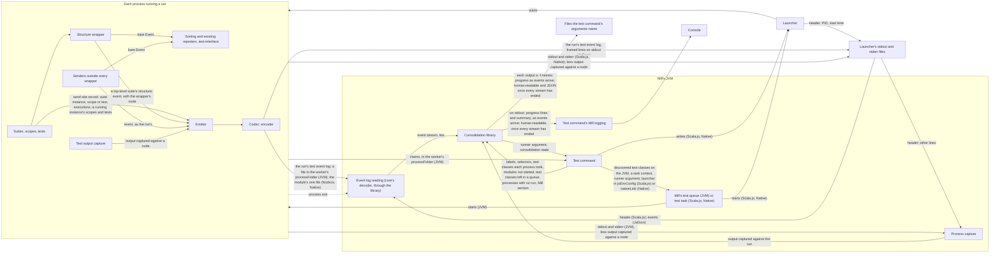

# Event-stream test reporting for Mill: architecture

Decisions: [ARCHITECTURE-DECISIONS.md](ARCHITECTURE-DECISIONS.md).

## Summary

Every run a test command starts must get its events, test structure and captured output out of its process on the JVM, Scala.js and Native, without changing what ScalaTest 3.2.x reporters receive (`SPECIFICATION.md` § Constraints). The test classes a process took to run must be known even where it dies before it sends anything. One Mill command must consolidate what every run sends, while Mill's own test tasks behave as they do without the plugin.

## Modules

Three deployable units. Every artifact of this fork, core's included, is published under Maven group `com.edc` (`ARCHITECTURE-DECISIONS.md` "Every artifact of this fork is published under Maven group `com.edc`…"). It is published only to the local Ivy repository (`~/.ivy2/local`), which Coursier, and so Mill, searches by default.

### ScalaTest core

Every artifact the fork's sbt build publishes, scalactic and the style artifacts included, keeps its upstream name and runtime and Scala-version suffixes, on every runtime and Scala version `SPECIFICATION.md` § Scope covers. A test module tests with this fork by depending on them as it would on upstream's, usually through `scalatest`. Every part below is in `scalatest-core`, which the other ScalaTest artifacts depend on, and is internal (`private[scalatest]`).

- **Structure wrapper** — an internal reporter handed to each suite, nested suite and test through `Args.reporter`. It hands each `Event` it receives to the emitter, unless another wrapper already has, so only the innermost wrapper an event reaches hands it off (`ARCHITECTURE-DECISIONS.md` "Structure is attached where each event is emitted…").
  - A wrapper that receives an event another wrapper has handed off still gives the emitter its own node. If the emitter holds that event, this places the event's suite instance (§ APIs § The emitter and the Mill plugin, item 3).
  - Sorting reporters hold events back, so each has ahead of it a wrapper for every node whose events it sorts, and the emitter receives each event as it is emitted.
  - A top-level suite's wrapper is installed before the suite's `SuiteStarting` is reported. As it is installed, it reads the suite's structure (§ APIs § The emitter and the Mill plugin, the `structure` event) from the constructed suite, its nested suites and the run's filter, and hands it to the emitter.
  - It hands each event off with its own node. The emitter resolves the event's node at or below that one (Emitter, below).
  - It passes the bare `Event` on to the reporter it wraps. It adds no event, removes none and changes no field, so every existing reporter receives what it receives without the wrapper (`SPECIFICATION.md` R-002).
- **Test output capture** — inside the run's process, captures output it can tie to a suite, scope or test against that node, and hands it to the emitter.
  - Output it captures against a node is withheld from the process's stdout and stderr; everything else passes through to them. `SPECIFICATION.md` R-088 forces this, because what passes through is captured again off those streams (§ APIs § The emitter and the Mill plugin).
- **Emitter** — when the runner argument is given, sends what § APIs § The emitter and the Mill plugin lists in the run's test event log.
  - Events sent outside every structure wrapper, such as the runner's own run events, reach it by an explicit hand-off where they are sent, assigned to the run (`ARCHITECTURE-DECISIONS.md` "Events sent outside every structure wrapper reach the emitter by an explicit hand-off at each send site.").
  - It assigns every node ID, unique within the run, and keeps for each suite the nodes it has sent, so that a node keeps its ID across `structure` events.
  - Where core sends an event, it records beside the event, in the emitter and never on the event, the suite instance, the registered scope or test, and the executions the event belongs to. The emitter resolves the event's node from that record. An event with no record, such as one user code builds, is resolved from its own data.
    - An event of a suite, scope or test is therefore assigned to its own node even where it bypasses that node's wrapper. Only a message that nothing identifies is assigned to the node of the wrapper that hands it off, an ancestor's (`SPECIFICATION.md` R-097).
  - It sends a further `structure` event (§ APIs § The emitter and the Mill plugin, the `structure` event) when it detects that the run has learned more of a suite's structure:
    - a suite instance runs whose scopes and tests differ from those it has sent;
    - a suite instance runs that it does not know, and no suite node it has sent is that instance's;
    - an event resolves to a suite or test it has not sent.
  - It numbers each node's executions (§ APIs § The emitter and the Mill plugin, item 3).
  - It is not a `-C` reporter opened on `RunStarting`, which could not send the `runStarted` event in time: on the JVM such a reporter can open after the runner's construction returns (`research/jvm-file-channel.md` § 5), and ScalaTest's Scala.js and Native runners ignore `-C` reporters and build no `RunStarting` (`research/node-native-file-channel.md` § 1).
- **Codec** — the one implementation of the event log's format (§ APIs § The emitter and the Mill plugin). The encoder runs in every run with the emitter on; the decoder runs in Mill's JVM. Each side is tested on its own against the format (`ARCHITECTURE-DECISIONS.md` "Each side of core's codec is tested on its own…").
  - It encodes and decodes the format by hand, since core builds for Scala 2.11 to 3 on the JVM, Scala.js and Native and takes no serialisation library.
  - The decoder yields each ScalaTest event as a member of the decoded event family, one class per `org.scalatest.events` class, holding what the event log carries of that event (`ARCHITECTURE-DECISIONS.md` "Core's decoder yields each ScalaTest event as a member of a decoded event family…").
  - An event's throwable decodes to core's decoded throwable, its cause and suppressed throwables included. A throwable met twice within one event decodes to the same object, so a cycle decodes as a cycle.
- **Argument splitter** — in package `org.scalatest.tools`, beside `ArgsParser`: takes ScalaTest arguments and returns them grouped by flag, each with its values. Its arities match `ArgsParser.parseArgs`'s, so that a flag's values are never read as flags. It runs in Mill's JVM (§ Data flow).

### Consolidation library

`scalatest-consolidation`, published as `scalatest-consolidation_3`: JVM and Scala 3 only, as its one caller, the Mill plugin, runs on Scala 3. It is in package `org.scalatest`, depends on scalatest-core and meets `SPECIFICATION.md` R-023. It takes each event stream in the form core's decoder yields it, and reuses four `private[scalatest]` parts of core, its formatting of human-readable output, its decoder, its argument splitter and its definition of the runner argument, which is why it sits in core's package.

- **Assembly** — builds each run's test structure from its event stream as it arrives.
  - It keeps each node's events against the node's ID, by execution, apart from the structure. The writers report each suite's latest structure, with those events.
  - A node the latest structure lacks stays at the place it last had while it has events, and is otherwise gone.
- **Runs that do not finish** — once a run's event stream ends without how the run ended, marks the run, and each node it left open, aborted (`SPECIFICATION.md` R-064).
  - For each run that did not finish, and each process that ended before any run existed in it, it reports by class name each test class the process took (§ Modules § Mill plugin, Test manifest) that no run reported as a suite (R-066, R-094). A class is shown once, however many processes took it.
- **Consolidation** — places every run's suites under the run's test run label, with one run record per run (R-078, R-080), beside the library's other inputs (§ APIs).
- **Writers** — write progress output as events arrive (R-026), and the human-readable and JSON output once every event stream has ended (R-027).
- **Consolidation state** — holds whether the consolidation has ended and whether anything has failed the test command (`SPECIFICATION.md` R-046). The library alone decides it, from what it is given (§ APIs § The Mill plugin and the consolidation library, **Read the consolidation state**).

### Mill plugin

`scalatest-mill`, published as `scalatest-mill_mill1_3`, Mill 1.x's plugin form. Built by its own Mill build inside this repo, not the sbt build, against the locally published scalatest-core and consolidation library. It hosts the consolidation library and adds the test command.

- Mill fixes the plugin's Scala version: Mill `1.3.1`, the release the plugin is built against, is built on Scala 3.9.0, while core's Scala 3 build is 3.3.8. The plugin loads core's Scala 3 build and the library into Mill's JVM.
- Its integration tests run under Mill's testkit.
- Mill API marked `@experimental` or `@internal`, or declared `private[mill]`, is used only from classes that the test command alone loads (`decisions/test-command.md` "On an unsupported Mill release, the test command runs and warns.").
- **Test command** — resolves the module selectors, runs every selected module's tests (§ Data flow), compiles each module's test manifest, and gives the library each run's event stream and its other inputs. It fails where the library's consolidation state says so, and interprets no event itself.
- **Test manifest** — gives the library the test classes each of a module's processes took, and those none took. A class's nested suites, scopes and tests are known only from a suite the run constructed (§ APIs § The emitter and the Mill plugin, the `structure` event). The test command writes no file for it (`ARCHITECTURE-DECISIONS.md` "The test manifest is compiled from Mill's test queue and claim files on the JVM…").
  - On the JVM it is the files of Mill's own test queue, which the test command lays out before it starts any worker (`research/mill-test-worker-args.md` § 1.2): each fork group's `test-classes/` queue, with one file for each class the test command's class globs keep, and each worker's `claim/` folder and `claim.log` in its `processFolder`. A fork group is known by its queue folder.
    - A class is either unclaimed in its group's queue or recorded in a worker's `claim.log`; a worker took each class its `claim.log` records. The test command compiles the manifest from these files once a worker has ended (§ APIs § The emitter and the Mill plugin).
    - A worker's claims are tied to the worker by its `processFolder`, even where the worker dies before it writes an event log: the test command starts each worker in a folder it chose.
    - On Windows two workers' `claim.log` can record one class while its file is in one `claim/` folder (`research/emitter-plugin-spike.md` § 2). Such a class is taken by both, and counts as reported if any run reported it.
    - The queue and claim layout is `@internal` to Mill. The test command already relies on it to drive the queue (`research/mill-test-worker-args.md` § 2.2; `research/mill-parallel-worker-capture.md` § 6).
    - The files last until the next test command clears the module's folder (§ APIs § The emitter and the Mill plugin).
  - Scala.js and Native have no queue and no claims. The test command holds the module's test classes in memory (§ Data flow), and the module's one process takes them all (§ External systems).
- **Event log reading** — reads each run's test event log live and turns it into that run's event stream (§ APIs § The Mill plugin and the consolidation library, **Decode**). It reads the event log file in each JVM worker's `processFolder`, each Scala.js `NodeJs` or Native module's one event log file and, under `JsDom`, the launchers' stdout files, and ends each stream as § APIs § The emitter and the Mill plugin describes.
- **Process capture** — captures each run's processes' stdout and stderr, against the run (`SPECIFICATION.md` R-042). On Scala.js and Native it takes them from launchers' files, each tied to its run by its header (§ APIs § The emitter and the Mill plugin), so that R-040, R-042 and R-073 hold there (`ARCHITECTURE-DECISIONS.md` "Every Scala.js VM starts through a launcher…" and "Every Native test binary starts through a launcher…").
- **Scala.js launcher** — starts every Scala.js VM, under `NodeJs` and `JsDom` alike, in place of the `executable` in the module's `jsEnvConfig`. It carries the module's launcher folder and the original `executable`, which it starts with the arguments and environment it receives: the config's `args` and `env`.
  - It writes the VM's stdout and stderr to its own pair of files in the module's launcher folder. The stdout file's first line is a header holding the VM's PID and a start time that matches `ProcessHandle`'s.
  - On Windows it is a small C program that runs the executable in a job object, so killing the launcher kills the VM. The plugin's own Mill build compiles it for x86-64 and ships it as a resource in the plugin jar; Windows on ARM64 runs it under emulation.
  - On POSIX (Linux and macOS) it is a `/bin/sh` script that `exec`s the executable, so the launcher becomes the VM. On Linux the header's start time comes from `/proc`. macOS has no `/proc`, so there the header carries the PID only, and the plugin takes the start time from `ProcessHandle` when it first reads the header.
- **Native launcher** — stands in for every Native test binary. It starts `<CROSSCOMPILING_EMULATOR words> <binary> <port>` itself, and writes the binary's stdout and stderr to its own pair of files in the module's launcher folder.
  - It is compiled with the module's `nativeClang`, because an emulator such as `qemu-user` cannot load a script. The launcher folder and the real binary's path are compiled into it, not passed through the environment, so the binary's environment is unchanged (`SPECIFICATION.md` R-053).
  - The stdout file's first line is a header holding the binary's PID and a start time that matches `ProcessHandle`'s.
- The test command writes each module's launcher into its launcher folder once per command, and swaps it into the module's test task (§ Data flow).

## APIs

### The emitter and the Mill plugin

- **The runner argument** — one ScalaTest runner argument, among those the test command adds to each run's arguments (`SPECIFICATION.md` R-053, R-125). Core alone defines its spelling and syntax; the test command gets each one from the library (§ APIs § The Mill plugin and the consolidation library, **Build the runner argument**). It turns the emitter on and turns off the reporter ScalaTest uses when no reporter is configured (`SPECIFICATION.md` R-041). It reaches the runner on every runtime and in every JS environment the epic covers.
  - Where the test event log is a file (below), the argument carries its path. On Scala.js under `NodeJs` and on Native that is the absolute path of the module's one event log file.
  - On the JVM each worker is given the absolute path of the file in its own `processFolder`, whether the module's test sandboxing (`testSandboxWorkingDir`) is on or off. A worker's framework arguments are those of the `TestModuleUtil` its subprocess call is made on, so the test command makes each worker's call on one built with that worker's arguments (`research/jvm-per-worker-event-log-path.md` § 1, § 2, § 5).
  - Mill's discovery runner, which is not a run, gets no runner argument and so opens no test event log (`SPECIFICATION.md` R-072; § Data flow). Scala.js and Native have no discovery runner (`research/mill-worker-channels.md` § 4).
- **The run's test event log** — carries exactly one run, in the codec's format, which is private and read only by the release that wrote it (`decisions/event-log-contract.md` "The test event log's format is private to this fork." and "A test event log is read only by the release of this fork that wrote it."). Its events are the consolidator events, `runStarted`, `structure` and `runEnded`, and the ScalaTest events. In order:
  1. the `runStarted` event: before the runner's construction returns, that the run exists (R-071, R-080), with:
     - on the JVM, under `NodeJs` and on Native, its process's PID;
     - on the JVM and Native, its process's start time;
     - under `JsDom`, the ID the run gives itself at construction;
  2. a `structure` event: when a top-level suite starts running, once ScalaTest's filter is known, that suite's structure after filtering:
     - the suite, with its node ID, name, `suiteId` and class name;
     - its nested suites, scopes and tests, each with its node ID, parent, declared position (its place among its siblings in declared order) and name, plus a `suiteId` and class name for a nested suite and a label for a scope or test.

     The run sends a further `structure` event for one suite, top-level or nested, whenever it learns more of that suite's structure:
     - where the suite instance that runs registers other scopes and tests than the structure already sent holds, as an instance constructed for the run can. The event precedes that instance's first scope or test event;
     - where a suite instance the run did not know of runs inside a suite, as one a test creates and runs, and either its suite node is new or it registers other scopes and tests than the structure already sent holds. Its suite node is the first that applies:
       1. that suite, where their `suiteId`s match;
       2. the nested suite directly under it with the instance's `suiteId`;
       3. a new nested suite directly under it, after its other children;
     - where an event with no record names a suite or test no `structure` event holds: that node is added.

     A further `structure` event holds that suite's node, with its parent where it is nested, and all its scopes and tests, which replace those the earlier events gave the suite. It holds none of the suite's nested suites, which keep the structure and place they have. Each node an earlier event held keeps its node ID;
  3. ScalaTest events, captured output, and what the outputs need that events lack (`research/emission-gap-analysis.md` § Short answer):
     - each assigned to its node by the node's ID, and only after the first `structure` event that holds that node;
       - The emitter holds, unwritten, the events of a suite instance the run did not know of. Once one of them reaches the structure wrapper of a suite instance whose node is known, the instance is placed (item 2). The emitter then writes, in order:
         1. the instance's further `structure` event, where item 2 calls for one;
         2. the held events, in the order they were sent.

         Events still held when the instance's `run` throws or the `Status` it returns completes reached no reporter of the run, and are dropped (`ARCHITECTURE-DECISIONS.md` "The emitter holds the events of a suite instance the run did not know of…");
     - each one assigned to a suite, scope or test with the number of the node's execution it belongs to. One assigned to a scope or test also has the number of its parent's execution it ran in;
     - events and messages attached to the run rather than to a suite, assigned to the run. Among them are the run events (`RunStarting`, `RunCompleted`, `RunStopped`, `RunAborted`, `DiscoveryStarting` and `DiscoveryCompleted`), which carry the run record's fields (`JSON-LAYOUT.md` § Run records; `ARCHITECTURE-DECISIONS.md` "The run's own state travels in the test event log as run events among the ScalaTest events.");
  4. the `runEnded` event: how the run ended (R-074), written once. The emitter derives it:
     - where the runner sends a closing run event, from that event alone, and writes it after that event: `RunCompleted` as completed, `RunStopped` as stopped and `RunAborted` as aborted. On the JVM `Framework`'s `done` sends `RunCompleted`;
     - otherwise from the runner's `done`, as completed.

  What the run sends:

  - `structure` events and ScalaTest events repeat for each top-level suite. No run sends a whole-run tree before it starts its first suite (`decisions/run-that-does-not-finish.md` "A suite's scopes and tests come from the run, one suite at a time…").
  - A run given no task sends no `structure` event, of the ScalaTest events only those assigned to the run, and the `runEnded` event only if it ends (R-071).
  - The event log carries only what the consolidated output shows or uses (`decisions/event-log-contract.md` "A test event log carries what the consolidated output shows or uses, not the whole event.").

  What the library takes:

  - How the run ended, from the `runEnded` event alone. A run whose event stream ends without the `runEnded` event does not finish (`SPECIFICATION.md` R-064), even where its closing run event arrived, as when the `runEnded` event is torn (only partly written) or the process dies between the two writes.
  - The run record's fields, from whichever run events arrived. A stream with the `runEnded` event but no run events, from a runner that sends none, is valid; its run record lacks those fields.

  How the event log carries events:

  - **Each event** is one line ending in `\n`, which the `JsDom` channel (below) forces on every runtime, since one codec serves them all. The line's first field names the event's kind.
    - The emitter writes each event as one write under one lock, so events written from different threads never interleave.
    - Event log reading decodes only whole lines, holding back unterminated bytes until more arrive.
    - A whole line that cannot be decoded ends the run's event stream there, so the run does not finish.
  - **On the JVM, on Scala.js under `NodeJs` and on Native,** the event log is one file per run, at the path the runner argument gives. The run appends each event to it unbuffered, as soon as the event's node is known (item 3 above), and the plugin reads it while the run appends (`ARCHITECTURE-DECISIONS.md` "On the JVM, on Scala.js under `NodeJs` and on Native, a run's test event log is one file per run.").
    - On the JVM the file has one fixed name, which Mill does not use, in the worker's `processFolder`. It is not in the worker's `sandbox`, so the tests' working directory holds nothing new (`SPECIFICATION.md` R-053). Mill writes a `processFolder`'s `testargs` with `CREATE_NEW`, so it starts at most one JVM there in one test command and the name cannot collide (`research/mill-test-worker-args.md` § 2.3). The plugin reads the file in each `processFolder` it starts a worker in.
    - On Scala.js and Native the file is in the folder the test command owns for the module (R-110). Mill's test task gives the module one run in one process (§ External systems), so the module has one event log file.
    - Before any test starts, each test command clears the folder it owns for each selected module, which holds every `processFolder`, and creates the module's launcher folder afresh. No earlier command's file is then read as a run (R-022, R-077), and Mill's `CREATE_NEW` write of `testargs` succeeds. The launcher folder holds the module's launcher and the file pairs it writes. Each task folder R-110 names is that task's Mill `Task.dest`.
    - The event log file never exists under its name without its complete `runStarted` event. On the JVM a `processFolder` that holds no event log file once its worker has ended is therefore a worker in which no run existed.
      - Such a worker gives no PID to watch (below). It has ended when Mill's test-runner subprocess call that started it returns. The plugin uses that return only where no event log file appeared; its captured output is then complete and its claims final.
  - **Under `JsDom`,** the event log is framed lines in the launcher's stdout file (`ARCHITECTURE-DECISIONS.md` "Under `JsDom`, a run's test event log is framed lines…"). The run writes each event as one line with the window's `console.log`, which jsdom forwards to Node's stdout.
    - A line is an event only if it begins with the frame: the framing prefix and this test command's nonce, both given by the runner argument, and the run's ID from the `runStarted` event. The event follows the frame. Every other line is ordinary output of the process (below).
    - An unterminated last line of the launcher's stdout file that begins with the framing prefix is a torn event. Any other unterminated last line is the process's last line of output (`SPECIFICATION.md` R-073).
  - **The end of a run's event stream** is the exit of the run's process (`ARCHITECTURE-DECISIONS.md` "The plugin learns that a run's stream has ended when the run's process exits.").
    - The plugin watches the process with `ProcessHandle`, given its PID and start time. On the JVM and Native these come from the `runStarted` event. On Scala.js they come from the header of the run's launcher (§ Modules § Mill plugin; below).
    - A PID counts as exited if it is already gone, has no start time, or its process's start time differs from the one given.
    - After the exit the plugin reads the event log to its end, since the exit can be signalled before the reader has caught up.
    - Bytes then left after the last `\n` are a torn event, and yield no event.
- **Each process's stdout and stderr** — carry everything the run's processes write that capture did not take against a node. The plugin captures them against the run. On Scala.js and Native they are the launcher's pair of files, without the header and, under `JsDom`, without the event log's events.
  - On the JVM a worker's stdout and stderr belong to the run whose event log file is in the worker's `processFolder`.
  - A pair belongs to the run whose `runStarted` event carries its header's PID, on Scala.js under `NodeJs` and on Native, and under `JsDom` to the run whose events its stdout file holds.
  - A pair is complete once the process its header names has exited, so the output of a process that ends before any run exists in it is captured whole (`SPECIFICATION.md` R-076).
  - On Native the header and the `runStarted` event carry the same PID and start time: the plugin ends the run's event stream by the `runStarted` event's, and the pair by the header's.

### The Mill plugin and the consolidation library

The Mill plugin is the library's only caller (`decisions/event-log-contract.md` "The consolidation library's API carries no compatibility promise…"). Its operations:

- **Split a module's ScalaTest arguments**: returns them grouped by flag, each with its values, from core's argument splitter (§ Modules § ScalaTest core), which the plugin, outside core's package, cannot call. The test command calls it before it starts the module's tests.
- **Build the runner argument** (§ APIs § The emitter and the Mill plugin): given what the argument carries, the event log file's absolute path or, under `JsDom`, the framing prefix and this test command's nonce, returns the argument as core defines it, which the plugin, outside core's package, cannot read. The test command calls it for each run it starts.
- **Decode a line of a run's test event log**: given one whole line without its `\n`, and under `JsDom` without its frame, returns the event it holds or that it cannot be decoded, from core's decoder (§ Modules § ScalaTest core, Codec), which the plugin, outside core's package, cannot call. Event log reading calls it for each line, then adds each event to the run's event stream (**Add a run**).
  - The plugin sees an event only as a handle exposing the `runStarted` event's PID and start time, which it watches the run's process by (§ APIs § The emitter and the Mill plugin, "The end of a run's event stream").
- **Start** a consolidation, given:
  - a sink for each output on stdout and in each file (`SPECIFICATION.md` R-048, R-049):
    - progress output on stdout: one for whole lines on stdout and one for the summary rewritten in place on Mill's prompt (R-089, R-090);
    - every other output: one text sink;
  - for each human-readable output, the formatting and filtering characters of the `-o` or `-f` that names it (R-127);
  - for human-readable output on stdout, whether Mill colours its own console output (R-124), which the plugin reads in Mill's JVM as `Task.log.prompt.colored` (`decisions/outputs.md` "Human-readable output on stdout is coloured where Mill colours its own console output.");
  - each module selector, with the test modules it resolved to;
  - where the caller gives them, the name and version of the build tool that started the runs, whether that version is supported, and a warning to show.
- **Add a run**: its event stream, fed live as the test event log is decoded, with the test run label the caller names for it, and the output captured from the stdout and stderr of the run's processes (`SPECIFICATION.md` R-042), as one sequence of lines in the order the caller read them, each line tagged with its stream.
  - The caller splits each stream into lines and decodes them to text before adding them, since a stream reaches it in chunks that can split a line or a character (`research/mill-worker-channels.md` § 1.3).
  - It adds a stream's unterminated last line once that stream ends, so a process that dies keeps its last line (R-073).

  Once the run's process has ended, the caller adds the test classes that process took, from the module's test manifest (§ Modules § Mill plugin).
- **Add a process that ended before any run existed in it** (`SPECIFICATION.md` R-076), with its test run label, the test classes it took, and the output captured from its stdout and stderr, in the form **Add a run** takes it.
- **Add a module whose tests did not start** (R-058, R-114), with its test run label and, where a failure stopped them, that failure.
- **Add a test class** left in a fork group's queue when the group's last worker ended (R-068).
- **End**, once every event stream has ended: the library writes the human-readable and JSON output. The consolidation state is ended once **End** returns, after that output is written.
- **Read the consolidation state**: returns, at once and at any time from **Start**, one of *open*, *open, failed*, *ended* and *ended, failed* (`ARCHITECTURE-DECISIONS.md` "The consolidation library, not the Mill plugin, decides whether the test command has failed." and "The library gives the consolidation state as a synchronous read of four states…").
  - The state is failed once the library has been given any cause of failure `SPECIFICATION.md` R-046 lists, and stays failed. It becomes failed when:
    - an event reporting a failure, or the `runEnded` event of a run that aborted or stopped, is added to a run's event stream;
    - a run's event stream ends without the `runEnded` event;
    - the caller adds a process that ended before any run existed in it, or a module whose tests did not start.
  - A not-run test class does not make it failed (R-115).
  - The test command reads the state after **End** and fails where it is *ended, failed*. Nothing else decides R-046 for it: the result of Mill's test-runner subprocess call plays no part.
  - The library notifies no one of a change; a caller that needs the state while the consolidation is open reads it again.

## Data flow

The test command runs each selected module's tests under a task context it supplies (`decisions/test-command.md` "A test module needs no change to its definition for the test command to run it."). It gives each run:

- the module's own ScalaTest arguments that `SPECIFICATION.md` R-125 allows, found with the argument splitter;
- the test command's class globs and framework arguments as ScalaTest arguments, converted where ScalaTest takes them in another form (R-053);
- the arguments it adds, among them the runner argument, which the library builds.

It runs the tests:

- on the JVM, it runs the module's test discovery itself without the runner argument, then drives Mill's test queue, starting each worker through Mill's test-runner subprocess call (`ARCHITECTURE-DECISIONS.md` "The plugin runs a module's test discovery itself…");
- on Scala.js and Native, it evaluates the module's own Mill test task. In that evaluation only, it swaps in the module's launcher: on Scala.js the value of `jsEnvConfig` becomes a copy whose `executable` is the launcher, and on Native the value of `nativeLink` becomes the launcher (`ARCHITECTURE-DECISIONS.md` "The plugin installs each launcher by replacing a task's value…").

Before it starts any of a module's test processes, the test command holds the module's test classes, from which it later compiles the test manifest (§ Modules § Mill plugin):

- on the JVM, as the queue it lays out for each fork group from its own discovery, which starts no test;
- on Scala.js and Native, from test classes it learns itself before it evaluates the test task, because Mill's test task discovers them only inside its own body (`research/mill-worker-channels.md` § 4).

All of this runs in one nested evaluation of the test command's own, with fail-fast off (`ARCHITECTURE-DECISIONS.md` "The test command runs every selected module's tests in one nested evaluation of its own…").

Under `--halt-on-failure`, once anything has failed the test command, it withholds the tests of every selected module not yet started (`SPECIFICATION.md` R-057). It can do so because it supplies each module's task context and, before it starts a module's tests, reads the consolidation state (§ APIs § The Mill plugin and the consolidation library), which is *open, failed* once anything has failed the test command.

*A run never writes to the console: what it reports reaches the console only through the consolidation library.*

- Progress output and human-readable output reach the console through the test command's Mill logging, which shares the console with Mill's prompt (`decisions/capture-and-console.md` "On the console, progress output is a one-line summary…").
- Failure path: a process that dies.
  - The run's event stream ends without how the run ended (§ APIs § The emitter and the Mill plugin), holding everything the run had handed to the operating system (`SPECIFICATION.md` R-073). The library treats it as a run that does not finish (R-064–R-067), and progress output shows it aborted as soon as the stream ends (R-067).
  - Because each top-level suite's structure, its nested suites included, arrives as the suite starts, every scope and test of a suite that started, and of every suite it nests, is known when the process dies (R-065), as the suite instance first constructed registers them. What only a further `structure` event would have added is not. A top-level suite the run never started sent nothing, so only its class is known, from the module's test manifest.
  - What the process wrote to stdout and stderr still reaches the library through process capture.
  - A process that dies before any run exists in it writes nothing to a test event log; the plugin adds it to the library with the output captured from its streams (R-076) and the test classes it took.
  - On the JVM the library still reports each class the dead worker took that no run reported, from the worker's claims (§ Modules § Mill plugin, Test manifest). A worker claims one class at a time, so that is at most the class it held when it died. Classes no worker claimed stay in the queue (R-068).

## External systems

- **Mill** — hosts the plugin in its JVM. Its fork grouping, test parallelism and test queue decide which processes run each module's tests. The test command must keep them, including on the JVM, where it drives the test queue itself (`SPECIFICATION.md` R-053). `ScalaJSModule.testFrameworkInstance` uses the module's `jsEnvConfig` only to build the JS environment, and `TestScalaNativeModule.testTask` uses `nativeLink` only as the test binary. That is what lets the test command swap in a launcher (`research/js-stdout-launcher.md` § 2.1; `research/mill-test-without-module-trait.md` § 3.3).
- **Scala.js and Native test adapters** — launch the Node VM or native binary that runs a Scala.js or Native run, in Mill's own working directory, and carry the framework arguments to its runner unchanged, including in `JsDom` window code (`research/js-environment-channels.md` § 2.2; `research/node-native-file-channel.md` § 7). Under Mill's test task each run executes in one Node VM or native binary, which carries no other run and exits shortly after it (`research/js-native-structure-and-capture.md` § 1.3; `research/node-native-file-channel.md` § 4, § 5.2).
  - The Scala.js adapter runs the `jsEnvConfig`'s `executable` with its `args` and `env`. When it closes a run it calls `destroyForcibly()` on that process, which on Linux closes Mill's pipes to it and discards what Mill had not read (`research/jsdom-channel.md` § 4).
  - The Native adapter runs `<CROSSCOMPILING_EMULATOR words> <binaryFile> <port>` on Mill's own stdin, stdout and stderr (`inheritIO()`), so no byte the binary writes passes through Mill's JVM (`research/js-native-channels.md` § 1.2, § 5.2).
  - `JsDom` window code has no `require` and no `process`, so a `JsDom` run can write no file, open no Node socket, and learn neither its PID nor its start time (`research/jsdom-channel.md` § 1).
- **Metals, Bloop and IntelliJ** — launch runs without the runner argument, so the emitter stays off and every reporter receives what 3.2.19 sends (`SPECIFICATION.md` R-001, R-003).
  - In IntelliJ's *forked* mode, its reporter writes TeamCity service messages (`##teamcity[…]`) to stdout, inferring each node's parent from `Ordinal` prefixes and `suiteId`. It needs each `SuiteStarting` and `ScopeOpened` before the tests inside it and every open closed, and silently drops event types it does not know.
  - In *sbt shell* mode, IntelliJ parses the text ScalaTest prints with regular expressions.
