# Structured test reporting: architecture

Decisions: [ARCHITECTURE-DECISIONS.md](ARCHITECTURE-DECISIONS.md).

## Summary

The test structure must travel with every event through a run without breaking compatibility with ScalaTest 3.2.x (`SPECIFICATION.md` § Constraints). The fork attaches it where each event is emitted and carries it beside the unchanged `Event` through ScalaTest's internal reporters and, across a run's processes, to the run's *main process*, the one process that receives all of them. It hands the structure only to reporters built to read it. Test output written during a run must likewise be attributed to nodes, on every platform, without changing what existing reporters receive.

## Modules

Three deployable units, each built and released from this repo.

### ScalaTest core

`scalatest-core`, on every Scala version and platform in `SPECIFICATION.md` § Scope. Changes live in `jvm/core`, plus the per-platform `tools` sources in `js/core` and `native/core` (`Framework`, `MasterRunner`, `SlaveRunner`, `TaskRunner`). Every part below is internal (`private[scalatest]`); Scala.js and Native receive the `jvm/core` parts through the existing source generators, `project/GenScalaTestJS.scala`, `project/GenScalaTestNative.scala` and their Dotty equivalents.

- **Structure wrapper** — an internal reporter handed to each suite, nested suite and test through `Args.reporter`, which envelopes every `Event` it receives.
  - An *envelope* is an `Event` or a chunk of test output, plus the ID of the node it attaches to and that node's parent's ID.
  - An envelope also carries its node's name as written in the source, its label (formatted name) and, for a suite, the source file of its registrations. `Engine` supplies all three; no 3.2.19 event carries the first or the last, nor a test's label before it closes.
  - Each suite's wrapper mints IDs for the suite, its scopes and its tests, unique within the run.
  - A run can span processes:
    - on Scala.js and Native, a *controller* process running `MasterRunner` and the *worker* processes, each running `SlaveRunner`, that the adapter starts for it (§ External systems);
    - under sbt's forked mode (`Test / fork := true`), the runner in sbt's JVM and the forked JVMs.
  - Each process has its own `Tracker`, so ordinals repeat across a run's processes. Every ID a process mints therefore carries a component unique to that process.
  - A wrapper knows its node's ID and its parent's, and tracks the scopes its node opens and closes.
  - Envelopes carry each child's declared position among its siblings, so structure-aware reporters restore declared order without the sorting reporters (`SPECIFICATION.md` § Human-readable output).
  - Each run's structure is rooted at a *run node*, to which run-level events (`RunStarting`, `RunCompleted`, `RunAborted`, discovery events) attach. Its wrapper wraps the reporter that `Runner`, the `Framework` and `MasterRunner` emit run-level events to, so every event passes through at least one wrapper.
  - Wrappers report to test output capture which tests and suites are running on each thread.
- **Envelope dispatch** — delivers each envelope to the *structure-aware reporters* of its process:
  - the human renderer's progress output, in each process that writes a reporter's progress output (§ Human renderer);
  - tree assembly, in the main process;
  - envelope forwarding, in every other process;
  - open-node tracking (§ Tree assembly), also in an sbt forked JVM.

  It sits ahead of `SuiteSortingReporter` and `TestSortingReporter` on every platform, because progress output streams results as they happen (`SPECIFICATION.md` § Progress output) and the sorting reporters hold events back. Scala.js and Native compile no `DispatchReporter`.
- **Envelope forwarding** — brings every envelope of a run to its main process: for `Runner`, its own process; for the JVM `Framework`, the JVM its runner was created in; on Scala.js and Native, the controller. Every other process sends each envelope on as soon as it exists:
  - On Scala.js and Native, each worker sends it to the controller through `notifyServer`.
  - Under sbt's forked mode, the forked JVM sends it over the socket that today carries its `Event`s to the runner in sbt's JVM. That runner already owns every `-f`, `-u`, `-h` and `-C` reporter; the forked JVM keeps only `-o`, written through its task loggers.
  - The main process renders the human-readable block and writes the JSON once every process's envelopes have arrived, or once `done()` gives up waiting for them. What marks the end of a process's envelopes depends on the path:
    - sbt's forked mode: the forked JVM closes its socket, and `done()` waits, for a fixed time as today, for the thread reading that socket until the last envelope has arrived. Whatever the fork had not yet reported when the wait gives up is unfinished (§ Tree assembly), even if the fork was only slow. Envelopes arriving after `done()` returns are dropped. A failed read on that socket means the forked JVM is gone; the sbt-side runner then emits `RunAborted`, as it does today, with reason *process failed* (§ Tree assembly).
    - Scala.js and Native: the adapter delivers each worker's messages before the controller's `done` runs (`research/js-native-structure-and-capture.md` § 2.2).
    - `Runner` and in-process runs: nothing is forwarded.
- **JSON writer** — serialises tree assembly's structure of the run as the one object of `SPECIFICATION.md` § JSON output, for every `J` reporter.
  - Tree assembly builds that structure from every envelope, unfiltered, so it is the one the marker carries. The writer applies a reporter's filter characters only to the data it writes on each node, and collapses nothing.
  - The main process writes it, because only that process receives every envelope of the run, from every process the object must cover.
  - `-fJ` writes the run's one JSON file at its path, with `-fJ`'s 3.2.19 meaning. `-oJ` and `-eJ` write the object through the channel that carries the human-readable block (§ Human renderer).
  - ScalaTest does not name the file and does not keep apart runs given the same path: their caller does (§ Mill plugin). On Scala.js the file is written through Node's `fs`; where `fs` cannot be loaded, as in an ES module where `process.getBuiltinModule` is absent (`research/js-native-structure-and-capture.md` § 2.3), `-fJ` writes no file and is a configuration error (`SPECIFICATION.md` § JSON output).
  - Every run with a `-fJ` reporter that can write its file leaves a file once it starts executing or reaches its end:
    - A run's *first execution* is the first task `execute` in its main process, or the first envelope of a node other than the run node to reach that process, whichever comes first. Constructing the runner and calling `tasks` do not count.
    - At the first execution, the main process writes a *marker*: a valid object for a run that ended in `RunAborted` with reason *process failed* (§ Tree assembly), listing the top-level suites known at that point. The marker carries structure only, never results.
    - When the main process learns of another top-level suite before the end, it rewrites the marker to include it. This happens wherever tasks are created after the first execution:
      - Mill's queue path, where each worker JVM claims classes one at a time (`research/mill-test-worker-args.md` § 1.2).
      - sbt's forked mode, when a later `testGrouping` group's forked JVM creates its tasks.

      A Scala.js or Native controller under sbt receives all of its run's tasks in one `tasks` call, before any executes.
    - A run whose end is reached — `done()` under the `Framework`, the end of the run under `Runner` — always writes its full object, whether or not it wrote a marker. Every write replaces the file atomically, so a reader never sees a partial object.
    - A *shutdown hook*, registered at the first execution and deregistered at the end, overwrites the marker on a soft death with the full tree: every known node, with results where they exist, ending in `RunAborted` with reason *process failed*. Its code is shared across platforms; each runtime supplies the exit handler.
    - A shutdown hook never writes over a file that another run has written since its own run's last write.
    - A run that dies leaves, on every platform, the marker, or the hook's tree where the hook fired. A hard death (SIGKILL, OOM kill, crash), and on Node any signal, leaves the marker.
  - The writer leaves no file from Mill's discovery runner, which never executes and never reaches `done()` (§ External systems).
- **Tree assembly** — assembles nodes into the test structure, restoring declared order, for the human renderer, the JSON writer and the consolidator.
  - Only its open-node tracking runs in every run, whatever reporters are configured: in the main process, and in each sbt forked JVM for that JVM's own runner. Full assembly runs only for the human-readable block, the JSON writer and the consolidator.
  - A top-level suite becomes a node when `Runner` is given or discovers it, or when the `tasks` of the JVM `Framework`'s runner or of `MasterRunner` creates its task, in whichever process that is; envelope forwarding brings it to the main process.
  - It gives the outcome aborted to every node the run was to execute that never finished, whether open or never started, but never to a node a filter excluded. In a live run, a node that never started, including one a `RunStopped` left unstarted, also gets reason *not run*. It does so when a suite containing the node ends, when its run ends, or when its input ends; in a live run, at the run's last envelope or once `done()` gives up waiting for it (`SPECIFICATION-DECISIONS.md` § A node left unfinished has outcome aborted, not a new outcome).
  - When a run finishes, it reports whether any node is unfinished: still open, with no suite containing it ended. If one is, and no closing run event (`RunCompleted`, `RunAborted` or `RunStopped`) has already passed the run node's wrapper, as the lost-fork `RunAborted` does (§ Envelope forwarding), `Runner`, the JVM `Framework`'s runner or `MasterRunner` emits `RunAborted` with reason *process failed* in place of `RunCompleted`, through the run node's wrapper, so every reporter and the JSON receive it (`SPECIFICATION.md` § Test structure).
  - An aborted node, the run node's `RunAborted` among them, may carry a reason, held in the structure, never in an `Event`, so reporters built against the 3.2.x API see the plain `RunAborted` or `SuiteAborted`, or nothing for a node that never started:
    - *process failed*: set by ScalaTest on a `RunAborted` when a process of the run failed or the run gave up waiting for one;
    - *not run*: set by ScalaTest on a node the run was to execute that never started, and by the consolidator on the entry for an absent file (§ Multi-run consolidation executable).
  - In an sbt forked JVM, `ForkMain`'s shutdown hook runs that JVM's own runner's `done()` (§ External systems), which applies the same rule to the nodes open in that JVM: it emits `RunAborted` to its own `-o` and over the socket, where, as today, `runTerminated` suppresses the sbt-side `RunCompleted`.
  - The fork's run-level events are not forwarded into the run's JSON as envelopes: as today, the sbt-side runner drops the fork's `RunStarting` and `RunCompleted` and dispatches its `RunAborted` and `RunStopped` through the run node's wrapper, so the JSON holds that `RunAborted`. A fork's `RunAborted` for unfinished nodes is recorded with reason *process failed*.
- **Human renderer** — writes `SPECIFICATION.md` § Human-readable output and § Progress output for each human-readable reporter, with that reporter's own configuration.
  - Assumption: `SPECIFICATION.md` § Progress output's "may not be run with HTML, XML or JSON" applies per reporter, not per invocation, so one run may have a `-o`, `-e` or `-f` writing progress output and a `-fJ` writing JSON, as every run the Mill plugin and the sbt recipe start does.
  - Progress output is written to `Runner`'s stdout and stderr, or, under the JVM `Framework`, through the loggers of the task that produced it, in the process running that task. A `-f` reporter's progress output and block go to its file, from the process that owns the reporter (§ Envelope forwarding).
  - On Scala.js and Native the controller writes all of a run's progress output, for every process of the run; workers only forward envelopes.
  - Under every `Framework`, a process writes through a task's loggers only while that task executes. Output it must write at any other time — its run-level events, and on Scala.js and Native the workers' envelopes — is held and written through the loggers of its next task; whatever is still held at its `done()` goes at the head of its `done()` string. It never writes this output to its stdout.
  - The human-readable block is rendered at the end of the run (§ Envelope forwarding), once for each human-readable reporter, from tree assembly. `Runner` writes each to its reporter's stdout, stderr or file; the `Framework` writes each `-f` block to its file and returns the console block whole as the `done()` string (§ External systems).
- **Test output capture** — attributes test output to nodes on every platform, for the reporters that consume it.
  - It captures a run's test output when the run has a reporter that consumes it: a human-readable reporter, which streams it as it is received, or a JSON reporter, which attaches it to the closest node (`SPECIFICATION.md` § Human-readable output, § JSON output, § Test output). A run whose reporters consume none, as with only `-C` reporters, is not captured (`SPECIFICATION-DECISIONS.md` § Test output is captured only when a reporter consumes it).
  - It learns which threads are running each run's nodes from the structure wrappers, and which are running each run's own code from `Runner`, the `Framework`'s runner and tasks, `MasterRunner`, `SlaveRunner` and `TaskRunner`, each of which marks a thread only while its own code is on it.
  - It routes each write to the run that owns it (`SPECIFICATION-DECISIONS.md` § A write belongs to the run whose node or own code is running on the writing thread, and output belonging to no run is never captured) and sends the write to that run's envelope dispatch as an envelope. Other output, owned by no run, passes through to the original stdout and stderr.
  - A run's captured test output does not pass through to the original stdout and stderr, except as allowed by `SPECIFICATION-DECISIONS.md` § Captured test output is withheld from stdout and stderr unless a `-C` reporter or a 3.2-format `-o` or `-e` reporter is configured; with a `-C` reporter, it reaches them (`SPECIFICATION.md` § Test output).
  - On the JVM, `scala.Console` takes `System.out` when it first loads, which the build tool or IDE has done before any run starts, so capture also sets `Console`'s output on each thread a run's node or own code is running on.
  - A process may hold several separately loaded copies of ScalaTest, as unforked sbt can. Their captures chain: each claims only the writes that its own runs own, passes the rest to the stream beneath it, and none is removed while another sits above it.

### Multi-run consolidation executable

A standalone executable, the *consolidator*, that writes the outputs of `SPECIFICATION.md` § Multi-run consolidation plugin. It rebuilds approximate `Event`s from the node state in ScalaTest's JSON, which holds no ordinals, formatters or rerunners, and renders with scalatest-core's internal tree assembly and human renderer.

- Its caller gives it one or more test run labels, unique within the consolidation, each with a list of JSON files. It merges each listed file's content under its label's node, keeping each file's closing run event and its reason, and does not collapse suites or tests that share a name across files.
- A listed file that is absent becomes an entry under its label holding a `RunAborted` with reason *not run* and no nodes.
- A label with no files appears as a label node with nothing under it.
- It classifies nothing: an absent file, a process that failed and failed tests appear only as the `RunAborted` reason and node outcomes. A label shows the results of all its files, so one file that failed never hides those that succeeded.
- Neither it nor ScalaTest tells one use of the caller's command from another. It reads every run in the files it is given, so the caller gives it only files from the runs the caller has just started: the Mill plugin as § Mill plugin says, and the sbt recipe by giving one label per module, covering that module's own `-fJ` path, and deleting the file before `test`.

### Mill plugin

`SPECIFICATION.md` § Multi-run consolidation plugin, the Mill plugin's command. The plugin, not ScalaTest, guarantees one JSON file per test-worker JVM and one test run label per module.

- Its command passes each selected JVM module's forked test command a relative `-fJ` path, which each test-worker JVM resolves against its own sandbox (§ External systems, Mill), so each run writes its own file.
- It fails the build for any selected JVM module whose `testSandboxWorkingDir` is off, before running its tests, because its worker JVMs would then share one working directory (§ External systems, Mill). It cannot force the setting on, because a user's override wins (`research/mill-test-worker-args.md` I-2).
- It gives the consolidator one test run label per selected module, named for the module's path in the build, which Mill keeps unique, so no two labels collide. Each label covers all the JSON files found under that module's sandboxes in the command's `Task.dest`: one for each worker JVM that reached its first execution or its `done()` (§ ScalaTest core, JSON writer).

## The compatibility boundary

No public `Event`, `Reporter`, `Args` or style-trait API is added or changed.

Envelopes cross processes only between ScalaTest's own code (§ Modules, envelope forwarding). Every existing reporter — `-oDU`, `-u`, `-h`, `-k`, `-K`, `-M`, `-C`, the GUI, and the `Framework`'s test-interface event handler — receives the bare `Event` it receives today. Only ScalaTest's envelope-carrying code — envelope dispatch, envelope forwarding, tree assembly and the structure-aware reporters, among them every human-readable `-o`, `-e` and `-f` other than `-oDU` (`SPECIFICATION.md` § Constraints § Compatibility with ScalaTest 3.2.x) — receives envelopes.

No reporter's writes are test output. ScalaTest's envelope-carrying code writes to a file, through the build tool's loggers, into the `done()` string, through `notifyServer` or the fork socket, or through the stdout and stderr taken before capture is installed. On the JVM, the existing reporters `DispatchReporter` drives, `-C` among them, run on its own thread, which runs no node or run code, so capture passes their writes through; the `Framework`'s sbt reporters, and on Scala.js and Native the one `-o` reporter, write through the build tool's loggers, not stdout.

A structure wrapper adds no event, removes none and changes no field: it decorates. An event the wrapper never sees still reaches every existing reporter.

Each wrapper sends its envelope straight to envelope dispatch and forwards the bare `Event` to its parent's wrapper. An enclosing wrapper envelopes only an `Event` instance no inner wrapper has enveloped, so a forwarder that keeps the instance — ScalaTest's sorting reporters or a third party's — causes no second envelope. Where a third-party reporter wrapper emits a new `Event`, or a suite's own `run` or `runNestedSuites` bypasses the wrappers, the event is enveloped by the enclosing structure wrapper that receives it, which belongs to an ancestor of the emitting node (`SPECIFICATION.md` § Test structure).

## Data flow

```mermaid
flowchart LR
  E[Suites, scopes, tests] --> W[Structure wrapper per node]
  W -- bare Event --> S[Sorting reporters]
  S -- bare Event --> R["Run node's wrapper"]
  G[Runner, Framework, MasterRunner] -- run-level events --> R
  R -- bare Event --> D["DispatchReporter (JVM only)"]
  D -- bare Event --> X[Existing reporters, -C, test-interface]
  W -- running nodes per thread --> T[Test output capture]
  L["Runner, Framework, MasterRunner, SlaveRunner, TaskRunner"] -- threads running run code --> T
  W -- envelope --> A["Envelope dispatch, in the emitting process"]
  R -- envelope --> A
  T -- "test output, in envelopes, for a human-readable or JSON reporter" --> A
  T -- "other output; test output with a -C reporter" --> P[Original stdout and stderr]
  A -- JVM --> HP["Human renderer: progress output"]
  HP -- progress output --> K["Build tool's loggers, a -f file, or stdout and stderr taken before capture"]
  A -- "worker: notifyServer; sbt fork: fork socket; else in process" --> M["Envelope dispatch, in the run's main process"]
  M -- "Scala.js, Native; -f under sbt's forked mode" --> HP
  M --> TA[Tree assembly]
  TA -- "nodes still open as the run finishes" --> G
  TA --> H["Human renderer: human-readable block"]
  H -- human-readable block --> Q["done() string, a -f file, or Runner's stdout or stderr"]
  HP -- "Framework: progress output still held at done()" --> Q
  TA --> J[JSON writer]
  J -- "-oJ, -eJ" --> Q
  J -- "-fJ: marker at first execution, replaced at the end or by the shutdown hook" --> F[("One JSON file per run, at -fJ's path")]
  F --> C[Consolidator]
  B["Mill plugin, sbt recipe, other callers"] -- "each test run label and its JSON files" --> C
  C -. uses .-> TA
  C -. uses .-> H
  C --> O["Consolidated JSON, human-readable and JUnit XML, each file's content under its test run label's node"]
```

*Existing reporters receive bare events after any sorting; structure-aware reporters receive envelopes before it. Each run's JSON and human-readable block come from its main process.*

- On Scala.js and Native, bare events go from the wrappers, through any `TestSortingReporter` an async suite installs, to the one `-o` reporter `TaskRunner` puts in `Args`.
- Failure path: a worker or forked JVM that dies leaves its unfinished nodes open.
  - Where `done()` still runs — after a Native worker dies, an sbt forked JVM calls `System.exit` or is lost, or the wait on the fork socket gives up — the run ends in `RunAborted` (§ Modules, envelope forwarding and tree assembly).
  - Where `done()` never runs — after a Scala.js worker dies, or when the run's main process dies or hangs, as a Mill test-worker JVM can — the run writes no human-readable block. Its JSON file is the marker, or the shutdown hook's tree where the hook fired (§ Modules, JSON writer).
  - Where the caller clears a run's `-fJ` path before the run, as the Mill plugin and the sbt recipe do (§ Modules, multi-run consolidation executable), an absent file therefore means no run there reached its first execution or its end.

## External systems

- **IntelliJ Scala plugin** — runs tests in forked, sbt-shell and BSP modes (`SPECIFICATION.md` § Constraints § IntelliJ). Its forked-mode reporter is loaded with `-C`, which forces the boundary above.
- **sbt** — drives the JVM `Framework` through test-interface.
  - Logging: progress output goes through each task's loggers. sbt logs the `done()` string, which carries the human-readable block, at `info` through the `test` task's logger as soon as each module's tests finish, and its `testResultLogger` setting can change that level or destination.
  - Unforked, it runs several modules' runs at once in its own JVM, each possibly under its own load of ScalaTest.
  - Forked, the runner stays in sbt's JVM and runs `done()` there, and the forked JVM runs the tasks; every forked `testGrouping` group belongs to that one run.
  - `System.exit`: a forked JVM's `ForkMain` runs that JVM's runner's `done()` from a shutdown hook (sbt `v1.11.7` `testing/agent/src/main/java/sbt/ForkMain.java`), so a forked JVM that calls `System.exit` closes its socket as one that finished does.
  - Failure: the `test` task fails alike when tests fail and when a forked JVM exits early or dies, so its result does not tell a dead process from failing tests (sbt `v1.11.7` `main/src/main/scala/sbt/ForkTests.scala`, and the `test` task in `main/src/main/scala/sbt/Defaults.scala`).
- **Mill** — drives the JVM `Framework` in forked test-worker JVMs.
  - Each worker JVM creates its own runner, and so its own run and file reporters, from identical arguments, env and system properties; no Mill hook gives one worker a value another lacks (`research/mill-test-worker-args.md` § 2.1, § 2.2).
  - While `testSandboxWorkingDir` is on, its default, each worker JVM of a command runs in its own working directory, `Task.dest[/<group>][/worker-<i>]/sandbox`, and Mill refuses to start a second JVM in one already used in the command (`research/mill-test-worker-args.md` § 2.3, I-1). While it is off, all of them run in `forkWorkingDir`, the workspace root by default.
  - Before any worker starts, Mill constructs one more runner from the same arguments, in its own process or a JVM-worker subprocess and outside any sandbox, to discover tests, and drops it without calling `done()` (`research/mill-test-worker-args.md` § 1.4).
  - It `println`s every logger line and the `done()` string to the task's stdout, line by line and with no level, so the `done()` string can interleave with other runs' output (`SPECIFICATION.md` § Mill).
  - A test-worker JVM that dies never calls `done()`, and Mill fails the task, as it does when tests fail, so the task result does not tell a dead process from failing tests (Mill `1.1.10` `TestModuleUtil`).
  - The plugin owns its command.
- **Metals and Bloop** — drive the `Framework` and read its test-interface events (`SPECIFICATION.md` § Constraints § Compatibility with ScalaTest 3.2.x).
- **Scala.js and Native test interface** — sbt and Mill drive the `Framework` through the platform's test adapter, which runs `MasterRunner` and `SlaveRunner` in JS VMs or native executables; today they carry one `-o` reporter and no file reporters. The adapter forces this shape (`research/js-native-structure-and-capture.md` § 1 and § 2):
  - The adapter runs a run's controller in the process of the build-tool thread that creates the runner, and starts a worker for each other build-tool thread that calls `tasks` or `execute`. A run's worker count is known only at `done()`.
  - The adapter keeps one process per build-tool thread, started on that thread's first call and reused by later runs, so one process can serve several runs and outlive them.
  - No ScalaTest code runs on the build tool's JVM; only the adapter does.
  - Under Mill, one thread drives the whole run: every task runs in the controller, no worker exists, and `notifyServer` is unused. Under sbt, tasks run on sbt's task threads, so a run can have several workers.
  - A worker reaches the controller only through `notifyServer`. Its messages arrive in order; messages from different workers interleave.
  - When a worker dies, Scala.js's `RunnerAdapter.done` (Scala.js `v1.20.2` `test-adapter/src/main/scala/org/scalajs/testing/adapter/RunnerAdapter.scala`), which awaits every worker's `done`, throws, and the controller's `done()` never runs. Native's (Scala Native `v0.5.12` `RunnerAdapter.done`) skips every process whose connection has closed and runs the controller's `done()` as usual.
  - The test interface hands loggers only to `Task.execute`, and the adapter detaches a task's logger handlers when `execute` returns (`research/js-native-structure-and-capture.md` § 2.1).
  - A process's stdout is unordered against the adapter's RPC. On Scala.js the adapter pipes it to the build tool's `System.out`; on Native the process inherits the build tool's file descriptors, which under the Mill daemon do not reach the console (`research/js-native-structure-and-capture.md` § 2.1).
- **CI JUnit XML readers** — consume the consolidator's JUnit XML, whose flat suite-and-case shape forces the nested structure to be flattened.
