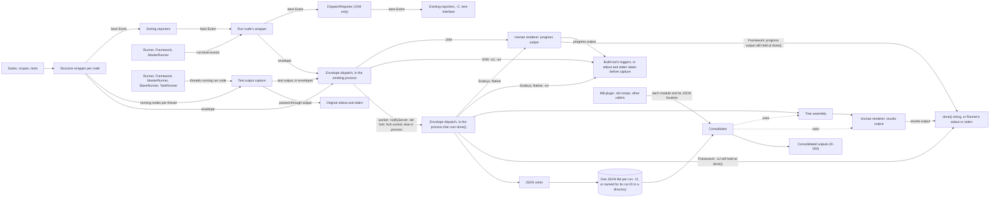

# Structured test reporting: architecture

Decisions: [ARCHITECTURE-DECISIONS.md](ARCHITECTURE-DECISIONS.md).

## Summary

The test structure must travel with every event through a run without breaking compatibility with ScalaTest 3.2.x (`SPECIFICATION.md` § Constraints). The fork attaches it where each event is emitted, carries it beside the unchanged `Event` through ScalaTest's internal reporters and, across a run's processes, to the one process that runs the run's `done()`, and hands it only to reporters built to read it. Test output written during a run must likewise be attributed to nodes, on every platform, without changing what existing reporters receive.

## Modules

Three deployable units, each built and released from this repo.

### ScalaTest core

`scalatest-core`, on every Scala version and platform in `SPECIFICATION.md` § Scope. Changes live in `jvm/core`, plus the per-platform `tools` sources in `js/core` and `native/core` (`Framework`, `MasterRunner`, `SlaveRunner`, `TaskRunner`). Every part below is internal (`private[scalatest]`); Scala.js and Native receive the `jvm/core` parts through the existing source generators, `project/GenScalaTestJS.scala`, `project/GenScalaTestNative.scala` and their Dotty equivalents.

- **Structure wrapper** — an internal reporter handed to each suite, nested suite and test through `Args.reporter`, which envelopes every `Event` it receives.
  - An *envelope* is an `Event` or a chunk of test output, plus the ID of the node it attaches to and that node's parent's ID.
  - Each suite's wrapper mints IDs for the suite, its scopes and its tests, unique within the run.
  - A run can span processes: on Scala.js and Native, a *controller* process running `MasterRunner` and the *worker* processes, each running `SlaveRunner`, that the adapter starts for it (§ External systems); under sbt's forked mode (`Test / fork := true`), the runner in sbt's JVM and the forked JVMs. Each process has its own `Tracker`, so ordinals repeat across a run's processes, and every ID a process mints carries a component unique to that process.
  - A wrapper knows its node's ID and its parent's, and tracks the scopes its node opens and closes.
  - Envelopes carry each child's declared position among its siblings, so structure-aware reporters restore declared order without the sorting reporters (`SPECIFICATION.md` R-011).
  - Each run's structure is rooted at a *run node*, to which run-level events (`RunStarting`, `RunCompleted`, `RunAborted`, discovery events) attach. Its wrapper wraps the reporter that `Runner`, the `Framework` and `MasterRunner` emit run-level events to, so every event passes through at least one wrapper.
  - Wrappers report to test output capture which tests and suites are running on each thread.
- **Envelope dispatch** — delivers each envelope to the *structure-aware reporters* of its process: the human renderer's progress output and any `-oJ` or `-eJ` in the process that writes the run's console output (§ Human renderer), tree assembly and the JSON writer in the process that runs `done()`, and envelope forwarding in every other process. Envelope dispatch sits ahead of `SuiteSortingReporter` and `TestSortingReporter` on every platform, because events held for sorting are lost on a crash (`SPECIFICATION.md` R-035); Scala.js and Native compile no `DispatchReporter`.
- **Envelope forwarding** — brings every envelope of a run to the process that runs the run's `done()`. For the JVM `Framework` that is the JVM its runner was created in; on Scala.js and Native, the controller. `Runner` has no `done()` and does everything in its own process, which this document's "the process that runs `done()`" includes. Every other process sends each envelope on as soon as it exists:
  - On Scala.js and Native, each worker sends it to the controller through `notifyServer`.
  - Under sbt's forked mode, the forked JVM sends it over the socket that today carries its `Event`s to the runner in sbt's JVM. That runner already owns every `-f`, `-u`, `-h` and `-C` reporter; the forked JVM keeps only `-o`, written through its task loggers.
  - `done()` renders results output and finishes the JSON file only after every process's envelopes have arrived. What marks the end of a process's envelopes depends on the path:
    - sbt's forked mode: the forked JVM closes its socket, and `done()` waits for the thread reading that socket until the last envelope has arrived. Today's `ScalaTestRunner.done` in `jvm/core/src/main/scala/org/scalatest/tools/Framework.scala` gives up that wait after 15 s.
    - Scala.js and Native: the adapter delivers each worker's messages before the controller's `done` runs (`research/js-native-structure-and-capture.md` § 2.2).
    - `Runner` and in-process runs: nothing is forwarded.
  - On Native, every `send` ScalaTest makes, of events, logger lines and envelopes, goes through one lock per process, because the adapter's own `send` takes none (`research/js-native-structure-and-capture.md` § 2.2).
- **JSON writer** — `SPECIFICATION.md` R-030 to R-036, R-064 and R-071.
  - The process that runs `done()` mints the run ID of `SPECIFICATION.md` R-033 when the run starts. Under sbt's forked mode, the runner in sbt's JVM passes it to the forked JVM in `remoteArgs`. On Scala.js and Native no worker writes JSON, so no worker needs the run ID.
  - The run's one JSON file is `-fJ`'s or R-071's `<dir>/<run ID>.json`. On Scala.js it is written through Node's `fs`; where `fs` cannot be loaded, as in an ES module where `process.getBuiltinModule` is absent (`research/js-native-structure-and-capture.md` § 2.3), both are the configuration error of R-036.
  - `Runner`'s `-oJ` and `-eJ` write each envelope as it arrives to the stdout or stderr taken before capture is installed.
  - `-oJ` passed to the `Framework` is written where its progress output is (§ Human renderer).
- **Tree assembly** — assembles nodes into the test structure, restoring declared order, for the human renderer and for the consolidator.
- **Human renderer** — `SPECIFICATION.md` R-020, R-022 to R-024 and R-058.
  - Progress output is written to `Runner`'s stdout and stderr, or, under the JVM `Framework`, through the loggers of the task that produced it, in the process running that task.
  - On Scala.js and Native the controller writes all of a run's progress output and `-oJ`, for every process of the run; workers only forward envelopes.
  - Under every `Framework`, a process writes through a task's loggers only while that task executes. Output it must write at any other time — its run-level events, and on Scala.js and Native the workers' envelopes — is held and written through the loggers of its next task; whatever is still held at its `done()` goes at the head of its `done()` string. It never writes this output to its stdout.
  - Results output is rendered once per run, from tree assembly, after the run's last envelope. `Runner` writes it to stdout or stderr; the `Framework` returns it whole as the `done()` string (§ External systems).
- **Test output capture** — attributes test output to nodes on every platform.
  - It learns which threads are running each run's nodes from the structure wrappers, and which are running each run's own code from `Runner`, the `Framework`'s runner and tasks, `MasterRunner`, `SlaveRunner` and `TaskRunner`, each of which marks a thread only while its own code is on it.
  - It routes each write to the run that owns it (`SPECIFICATION.md` R-070), captures it only when R-061 holds for that run, and sends it to that run's envelope dispatch as an envelope. Every other write, and every captured write R-063 does not withhold, passes through to the original stdout and stderr.
  - On the JVM, `scala.Console` takes `System.out` when it first loads, which the build tool or IDE has done before any run starts, so capture also sets `Console`'s output on each thread a run's node or own code is running on.
  - On Scala Native it is installed when the `Framework` loads, before anything initialises `scala.Console`, and passes every write through while no run owns it.
  - A process may hold several separately loaded copies of ScalaTest, as unforked sbt can. Their captures chain: each claims only writes its own runs own, passes the rest to the stream beneath it, and none is removed while another sits above it.

### Consolidator

A standalone executable that writes the outputs of `SPECIFICATION.md` R-050. Toward third parties its only contract is the documented JSON format (R-037); it rebuilds `Event`s from the JSON and renders results output with scalatest-core's internal tree assembly and human renderer.

- Its caller names each module and that module's JSON location. Neither it nor ScalaTest tells one use of the caller's command from another: it reads every run in each location, so the caller gives it locations holding only the runs the caller has just started. The sbt recipe gives each module its own directory and deletes it before `test`.
- It namespaces node IDs by run ID, so node IDs stay distinct across runs (`SPECIFICATION.md` R-014).

### Mill plugin

`SPECIFICATION.md` R-053 and R-056.

- Points each module's R-071 directory argument at a directory inside its command's `Task.dest`, which Mill empties before each run of the task. Every test-worker JVM of the module writes its own run's file there.

## The compatibility boundary

No public `Event`, `Reporter`, `Args` or style-trait API is added or changed.

Envelopes cross processes only between ScalaTest's own code (§ Modules, envelope forwarding). Every existing reporter — 3.2-format `-o` and `-e`, `-f` without `J`, `-u`, `-h`, `-k`, `-K`, `-M`, `-C`, the GUI, and the `Framework`'s test-interface event handler — receives the bare `Event` it receives today. Only ScalaTest's envelope-carrying code — envelope dispatch, envelope forwarding, tree assembly and the structure-aware reporters — receives envelopes.

No reporter's writes are test output (`SPECIFICATION.md` R-068). ScalaTest's envelope-carrying code writes to a file, through the build tool's loggers, into the `done()` string, through `notifyServer` or the fork socket, or through the stdout and stderr taken before capture is installed. On the JVM, the existing reporters `DispatchReporter` drives, `-C` among them, run on its own thread, which runs no node or run code, so capture passes their writes through; the `Framework`'s sbt reporters, and on Scala.js and Native the one `-o` reporter, write through the build tool's loggers, not stdout.

A structure wrapper adds no event, removes none and changes no field: it decorates. An event the wrapper never sees still reaches every existing reporter.

Each wrapper sends its envelope straight to envelope dispatch and forwards the bare `Event` to its parent's wrapper. An enclosing wrapper envelopes only an `Event` instance no inner wrapper has enveloped, so a forwarder that keeps the instance — ScalaTest's sorting reporters or a third party's — causes no second envelope. Where a third-party reporter wrapper emits a new `Event`, or a suite's own `run` or `runNestedSuites` bypasses the wrappers, the event is enveloped by the enclosing structure wrapper that receives it, which belongs to an ancestor of the emitting node (`SPECIFICATION.md` R-013).

## Data flow

*Existing reporters receive bare events after any sorting; structure-aware reporters receive envelopes before it. Each run's JSON file and results output come from the one process that runs its `done()`, which on Scala.js and Native also writes all of the run's console output.*

- On Scala.js and Native, bare events go from the wrappers, through any `TestSortingReporter` an async suite installs, to the one `-o` reporter `TaskRunner` puts in `Args`.
- The JSON writer writes each envelope as it arrives (`SPECIFICATION.md` R-035), so envelopes from different workers interleave in arrival order.
- The consolidator receives the JSON of many runs, from many modules, JVMs and platforms, and tells them apart by run ID.
- Failure path: a worker or forked JVM that dies loses at most the envelope it was sending (`SPECIFICATION.md` R-035). A process that runs `done()` and dies or hangs leaves a partial JSON file and no results output, and a module that never ran leaves no file in its JSON location (`SPECIFICATION.md` R-051).

## External systems

- **IntelliJ Scala plugin** — runs tests in forked, sbt-shell and BSP modes (`SPECIFICATION.md` § Constraints § IntelliJ). Its forked-mode reporter is loaded with `-C`, which forces the boundary above.
- **sbt** — drives the JVM `Framework` through test-interface. Progress output goes through each task's loggers. sbt logs the `done()` string, which carries results output, at `info` through the `test` task's logger as soon as each module's tests finish, and its `testResultLogger` setting can change that level or destination (`SPECIFICATION.md` R-022, R-023). Unforked, it runs several modules' runs at once in its own JVM, each possibly under its own load of ScalaTest. Forked, the runner stays in sbt's JVM and runs `done()` there, and the forked JVM runs the tasks; every forked `testGrouping` group belongs to that one run.
- **Mill** — drives the JVM `Framework` in forked test-worker JVMs, each creating its own runner, and so its own run and file reporters, from identical arguments. It `println`s every logger line and the `done()` string to the task's stdout, line by line and with no level, so the `done()` string can interleave with other runs' output (`SPECIFICATION.md` R-058). The plugin owns its command.
- **Metals and Bloop** — drive the `Framework` and read its test-interface events (`SPECIFICATION.md` R-004).
- **Scala.js and Native test interface** — sbt and Mill drive the `Framework` through the platform's test adapter, which runs `MasterRunner` and `SlaveRunner` in JS VMs or native executables; today they carry one `-o` reporter and no file reporters. The adapter forces this shape (`research/js-native-structure-and-capture.md` § 1 and § 2):
  - The adapter runs a run's controller in the process of the build-tool thread that creates the runner, and starts a worker for each other build-tool thread that calls `tasks` or `execute`. A run's worker count is known only at `done()`.
  - The adapter keeps one process per build-tool thread, started on that thread's first call and reused by later runs, so one process can serve several runs and outlive them.
  - No ScalaTest code runs on the build tool's JVM; only the adapter does.
  - Under Mill, one thread drives the whole run: every task runs in the controller, no worker exists, and `notifyServer` is unused. Under sbt, tasks run on sbt's task threads, so a run can have several workers.
  - A worker reaches the controller only through `notifyServer`. Its messages arrive in order; messages from different workers interleave.
  - The test interface hands loggers only to `Task.execute`, and the adapter detaches a task's logger handlers when `execute` returns (`research/js-native-structure-and-capture.md` § 2.1).
  - A process's stdout is unordered against the adapter's RPC. On Scala.js the adapter pipes it to the build tool's `System.out`; on Native the process inherits the build tool's file descriptors, which under the Mill daemon do not reach the console (`research/js-native-structure-and-capture.md` § 2.1).
  - The controller's `done()` string cannot be a run's JSON channel, because a crash loses it (`SPECIFICATION.md` R-035), though it carries at its head any `-oJ` objects the controller still holds (§ Modules, human renderer). `sbt.testing.Event`, whose fields are fixed (R-004), cannot carry the JSON either.
- **CI JUnit XML readers** — consume the consolidator's JUnit XML, whose flat suite-and-case shape forces the nested structure to be flattened.
