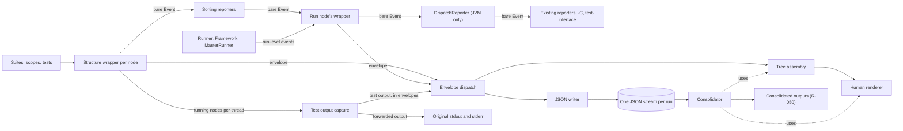

# Structured test reporting: architecture

Decisions: [ARCHITECTURE-DECISIONS.md](ARCHITECTURE-DECISIONS.md).

## Summary

The test structure must travel with every event through a run without breaking compatibility with ScalaTest 3.2.x (`SPECIFICATION.md` § Constraints). The fork attaches it where each event is emitted, carries it through ScalaTest's internal reporters beside the unchanged `Event`, and hands it only to new reporters built to read it. Test output written during a run must likewise be attributed to nodes, on every platform, without changing what existing reporters receive.

## Modules

Three deployable units, each built and released from this repo.

### ScalaTest core

`scalatest-core`, on every Scala version and platform in `SPECIFICATION.md` § Scope. Changes live in `jvm/core`, plus the per-platform `tools` sources in `js/core` and `native/core` (`Framework`, `MasterRunner`, `SlaveRunner`, `TaskRunner`). Every part below is internal (`private[scalatest]`); Scala.js and Native receive the `jvm/core` parts through the existing source generators, `project/GenScalaTestJS.scala`, `project/GenScalaTestNative.scala` and their Dotty equivalents.

- **Structure wrapper** — an internal reporter handed to each suite, nested suite and test through `Args.reporter`. Each suite's wrapper mints IDs for the suite, its scopes and its tests. A wrapper knows its node's ID and its parent's node ID, tracks the scopes its node opens and closes, and wraps every `Event` it receives into an *envelope*: an `Event` or a chunk of test output, plus the ID of the node it attaches to and that node's parent's ID. Each wrapper knows each child's declared position among its siblings, and envelopes carry it, so structure-aware reporters restore declared order without the sorting reporters (`SPECIFICATION.md` R-011). The run node's wrapper wraps the reporter that `Runner`, the `Framework` and `MasterRunner` emit run-level events to, so every event passes through at least one wrapper. Wrappers report which tests and suites are running on each thread to test output capture.
- **Envelope dispatch** — delivers each envelope to the *structure-aware reporters*, the JSON writer and the human renderer. Envelope dispatch sits ahead of `SuiteSortingReporter` and `TestSortingReporter` on every platform, because events held for sorting are lost on a crash (`SPECIFICATION.md` R-035); Scala.js and Native compile no `DispatchReporter`.
- **JSON writer** — `SPECIFICATION.md` R-030 to R-036.
- **Tree assembly** — assembles nodes into the test structure, restoring declared order, for the human renderer and for the consolidator.
- **Human renderer** — the default output of `SPECIFICATION.md` § Human-readable output: R-020, R-022 to R-024 and R-058.
- **Test output capture** — active only when `SPECIFICATION.md` R-061 holds. On Scala Native it is installed when the `Framework` loads, before anything initialises `scala.Console`, and passes everything through until activated. It attributes test output to nodes and sends it to envelope dispatch as envelopes, and passes output through to the original stdout and stderr under R-062 and R-007.

### Consolidator

A standalone executable that writes the outputs of `SPECIFICATION.md` R-050. Toward third parties its only contract is the documented JSON format (R-037); it rebuilds `Event`s from the JSON and renders results output with scalatest-core's internal tree assembly and human renderer.

### Mill plugin

`SPECIFICATION.md` R-053 and R-056.

## The compatibility boundary

No public `Event`, `Reporter`, `Args` or style-trait API is added or changed.

Envelopes never leave ScalaTest's internal reporters. Every existing reporter — 3.2-format `-o` and `-e`, `-f`, `-u`, `-h`, `-k`, `-K`, `-M`, `-C`, the GUI, and the `Framework`'s test-interface event handler — receives the bare `Event` it receives today. Only the structure-aware reporters receive envelopes. Every reporter, existing or structure-aware, writes to the original stdout and stderr, never through test output capture.

A structure wrapper adds no event, removes none and changes no field: it decorates. An event the wrapper never sees still reaches every existing reporter.

Each wrapper sends its envelope straight to envelope dispatch and forwards the bare `Event` to its parent's wrapper. An enclosing wrapper envelopes only an `Event` instance no inner wrapper has enveloped, so a forwarder that keeps the instance — ScalaTest's sorting reporters or a third party's — causes no second envelope. Where a third-party reporter wrapper emits a new `Event`, or a suite's own `run` or `runNestedSuites` bypasses the wrappers, the event is enveloped by the enclosing structure wrapper that receives it, which belongs to an ancestor of the emitting node (`SPECIFICATION.md` R-013).

## Data flow

*Existing reporters receive bare events after any sorting; structure-aware reporters receive envelopes before it.*

- On Scala.js and Native, bare events go from the wrappers, through any `TestSortingReporter` an async suite installs, to the one `-o` reporter `TaskRunner` puts in `Args`, and one run's events originate in several processes (§ External systems). Each process has its own ordinal tracker, so ordinals repeat across the processes of one run.
- Each run's structure is rooted at a run node; run-level events (`RunStarting`, `RunCompleted`, `RunAborted`, discovery events) attach to it.
- The JSON writer writes each event as it arrives (`SPECIFICATION.md` R-035).
- The consolidator receives the JSON of many runs, from many modules, JVMs and platforms; run identity and globally unique node IDs keep them apart.
- Failure path: a run that crashes leaves a partial stream, and a module that never ran leaves none (`SPECIFICATION.md` R-051).

## External systems

- **IntelliJ Scala plugin** — runs tests in forked, sbt-shell and BSP modes (`SPECIFICATION.md` § Constraints § IntelliJ). Its forked-mode reporter is loaded with `-C`, which forces the boundary above.
- **sbt** — drives the JVM `Framework` through test-interface; human output goes through sbt's loggers (`SPECIFICATION.md` R-022).
- **Mill** — drives the JVM `Framework` in forked JVMs; the plugin owns its command.
- **Metals and Bloop** — drive the `Framework` and read its test-interface events (`SPECIFICATION.md` R-004).
- **Scala.js and Native test interface** — sbt and Mill drive the `Framework` through the platform's test adapter, which runs `MasterRunner` and `SlaveRunner` in JS VMs or native executables; today they carry one `-o` reporter and no file reporters. The adapter forces this shape (`research/js-native-structure-and-capture.md` § 1 and § 2):
  - One run is one *controller process*, running `MasterRunner`, plus one *worker process*, running `SlaveRunner`, for each other build-tool thread that calls `tasks` or `execute`, started on that thread's first call. A run's worker count is known only at `done()`.
  - No ScalaTest code runs on the build tool's JVM; only the adapter does.
  - Under Mill, one thread drives the whole run: every task runs in the controller, no worker exists, and `notifyServer` is unused. Under sbt, tasks run on sbt's task threads, so a run can have several workers.
  - A worker reaches the controller only through `notifyServer`. Its messages arrive in order; messages from different workers interleave.
  - Neither the controller's `done()` summary string, which a crash loses (`SPECIFICATION.md` R-035), nor `sbt.testing.Event`, whose fields are fixed (R-004), can carry the JSON.
- **CI JUnit XML readers** — consume the consolidator's JUnit XML, whose flat suite-and-case shape forces the nested structure to be flattened.
